# jsb-update

『점프 투 스프링부트』의 기능을 구현하면서, 장희성 강사의 14163·14168 강의 내용을 적용해 개선하는 프로젝트입니다.

## 환경
- Spring Boot 4.1.2
- Java 25
- Gradle (Kotlin DSL)
- 의존성: Spring Web MVC, Thymeleaf(+ layout dialect, springsecurity6), Spring Data JPA, H2, Spring Security, Validation, Lombok, DevTools, commonmark

## 참고 자료
- [점프 투 스프링부트 교재](https://wikidocs.net/book/7601) / 교재 코드 [pahkey/sbb3](https://github.com/pahkey/sbb3) (절별 태그 `v2.03` ~ `v3.13`)
- [14163 강의 — 점프 투 스프링부트 개선](https://www.slog.gg/p/14163/raw) / [jhs512/p-14163-2](https://github.com/jhs512/p-14163-2)
- [14168 강의 — JPA, 타임리프 개선](https://www.slog.gg/p/14168/raw) / [jhs512/p-14168-2](https://github.com/jhs512/p-14168-2)

## 실행 방법
```bash
./gradlew bootRun
```
- `http://localhost:8080` → 질문 목록
- 샘플 회원: `admin`, `user1`, `user2` (비밀번호 모두 `1234`, 개발·테스트용)
- 개발 실행(dev 프로필)에서는 페이징 확인용 질문 300개가 추가로 만들어짐
- H2 콘솔: `http://localhost:8080/h2-console` (JDBC URL `jdbc:h2:./db_dev;MODE=MySQL`, 사용자 `sa`)
- 개발용 메일함: `http://localhost:8080/dev/mailbox` (비밀번호 찾기 메일이 실제로 나가지 않고 여기에 쌓임)

### 카카오 로그인 실행
키는 저장소에 올리지 않고 환경 변수로 넣습니다. 키가 없으면 로그인 화면에 카카오 버튼이 보이지 않습니다.
1. [카카오 디벨로퍼스](https://developers.kakao.com)에서 애플리케이션 생성
2. 카카오 로그인 활성화, Redirect URI에 `http://localhost:8080/login/oauth2/code/kakao` 등록
3. 보안 메뉴에서 Client Secret 발급·활성화
4. REST API 키와 Client Secret을 환경 변수로 넣고 실행
```bash
KAKAO_CLIENT_ID=REST_API_키 KAKAO_CLIENT_SECRET=시크릿 ./gradlew bootRun
```

## 결과 화면

| 질문 목록 (페이징·검색창·글쓴이·답변 개수) | 질문 상세 (답변·추천·수정·삭제) |
|---|---|
| 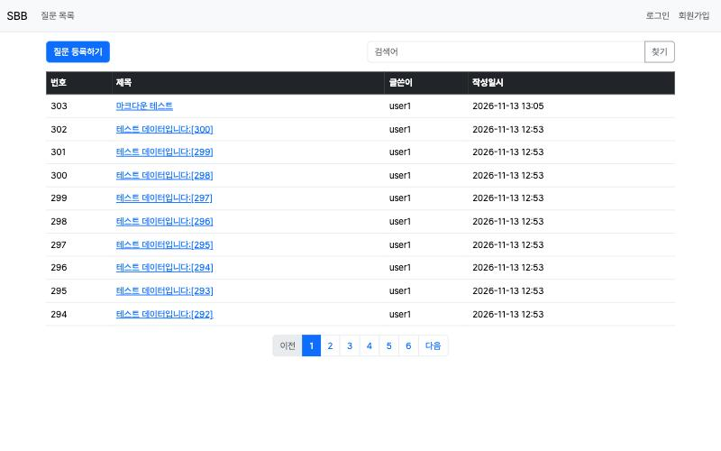 | 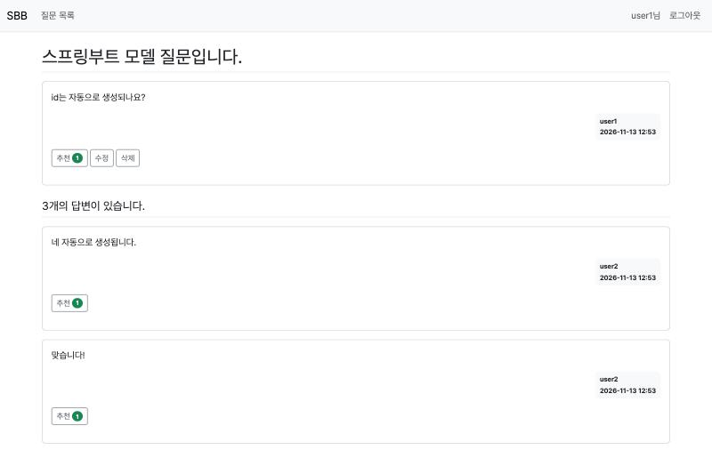 |
| 기능 015 · 019 · 024 | 기능 011 · 019 · 020 · 021 |

| 질문 등록 입력값 검증 (정렬된 에러) | 수정일시 표시 |
|---|---|
| 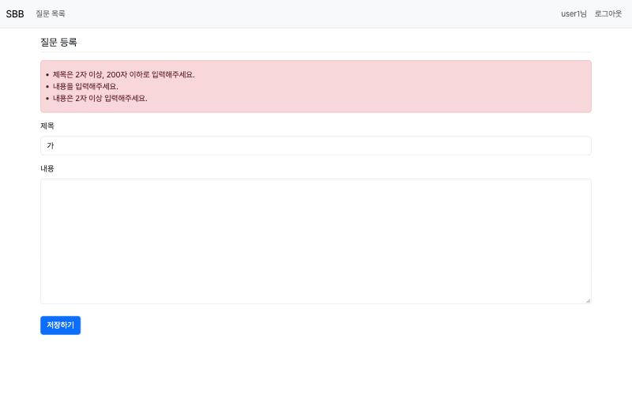 | 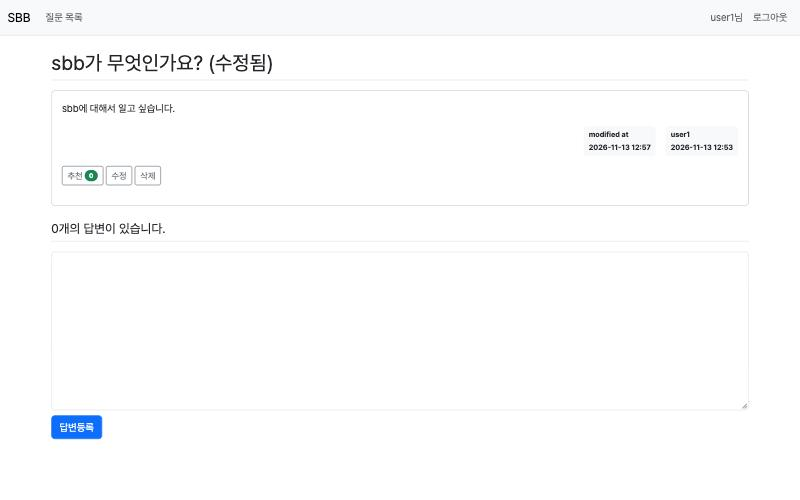 |
| 기능 013 | 기능 020 |

| 회원가입 (중복 아이디·비밀번호 불일치) | 로그인 실패 |
|---|---|
| 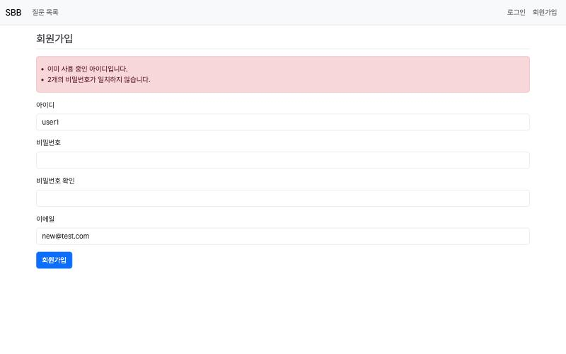 | 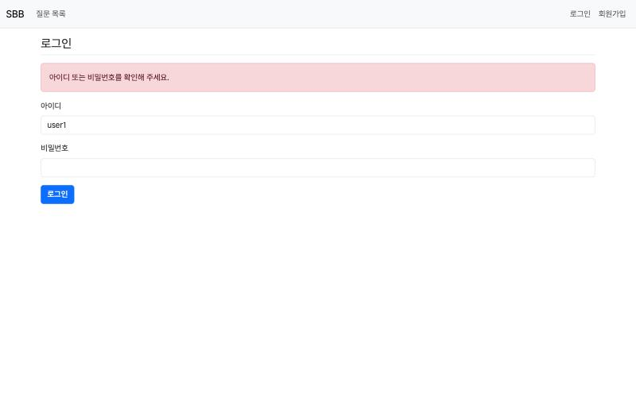 |
| 기능 017 | 기능 018 |

| 마크다운 (직접 쓴 `<script>`는 글자로) | 검색 (답변 내용까지 검색) |
|---|---|
| 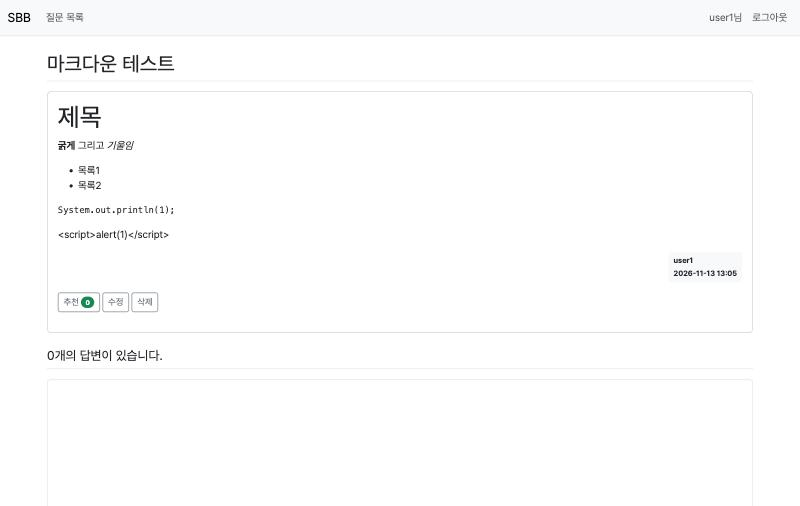 | 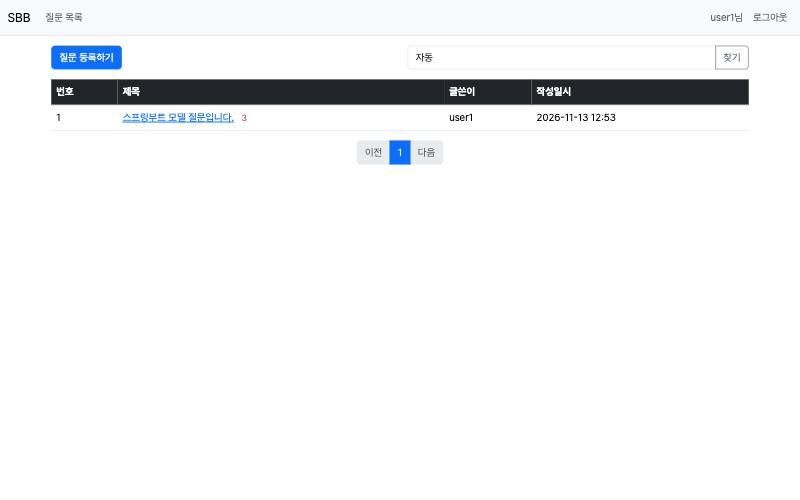 |
| 기능 023 | 기능 024 |

| 답변 추천순 정렬·조회 수·카테고리·댓글 | 카테고리 탭 |
|---|---|
| 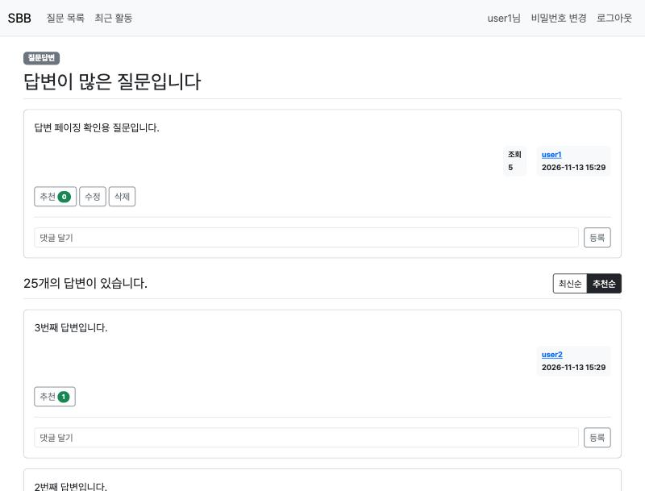 | 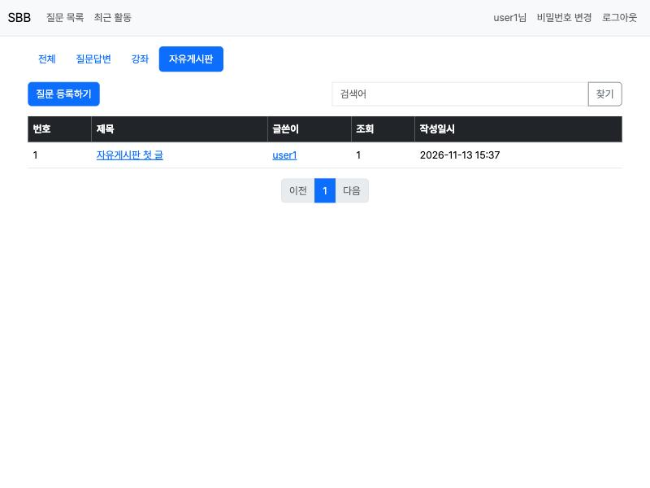 |
| 기능 026 · 027 · 028 · 029 | 기능 028 |

| 최근 활동 (최근 답변·댓글) | 비밀번호 찾기 (개발용 메일함) |
|---|---|
| 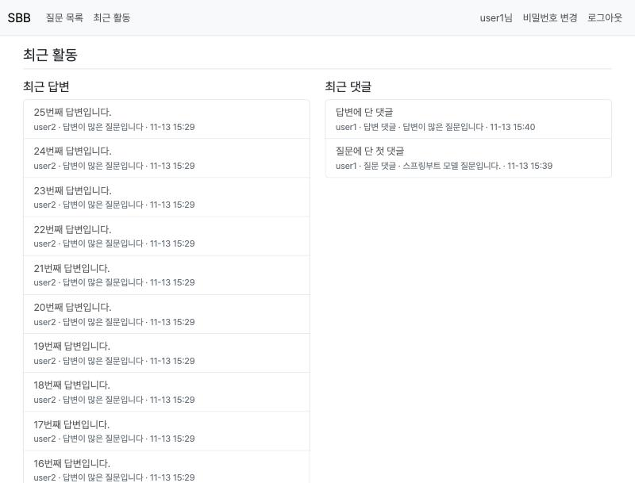 | 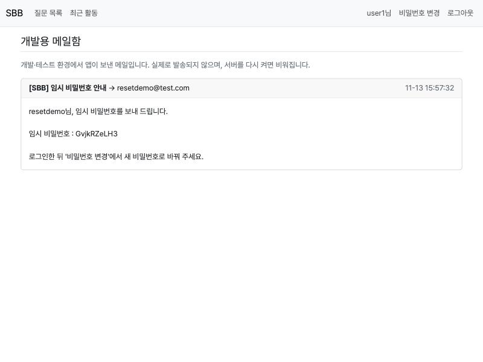 |
| 기능 030 | 기능 032 |

| 프로필 (쓴 질문·답변·댓글) | 마크다운 편집기 (나란히 보기) |
|---|---|
| 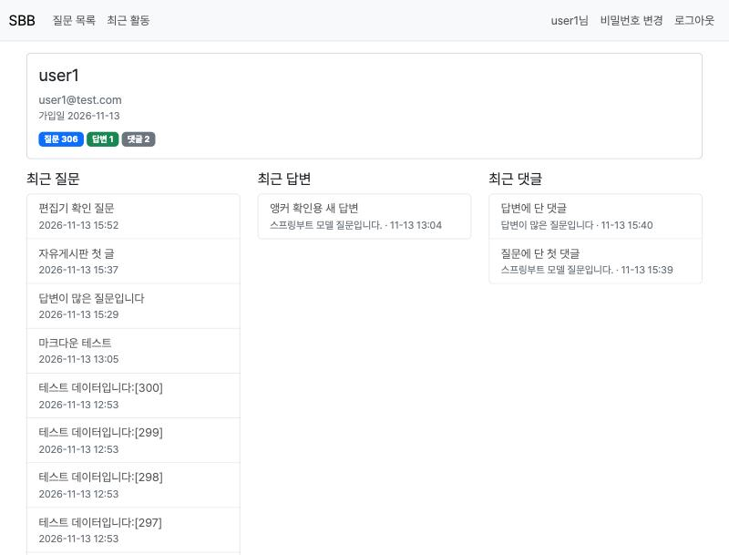 | 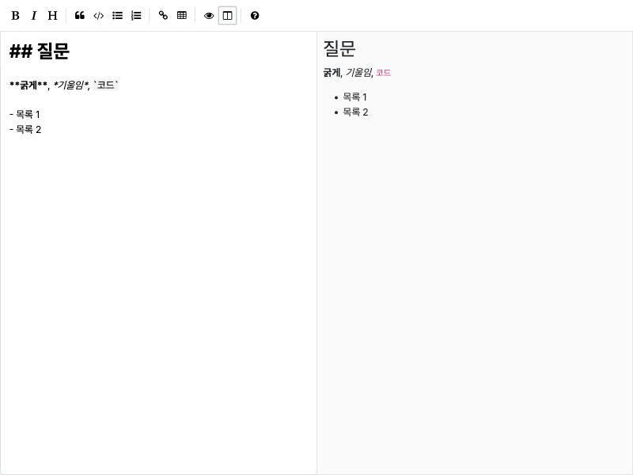 |
| 기능 033 | 기능 034 |

## 커밋을 하나씩 따라가는 방법
- 커밋 번호는 `기능번호-단계번호`입니다. 예) `020-02` = 20번째 기능(수정·삭제)의 2단계(질문 삭제)
- 각 커밋에는 같은 이름의 태그가 있습니다. 아래 작업내역의 `[링크]`를 누르면 그 시점의 코드 전체를 볼 수 있습니다.
- 기능 번호만으로도 볼 수 있습니다: `https://github.com/Minse5k/jsb-update/commit/002` (기능 002의 마지막 단계)
- 그 단계에서 바뀐 코드만 보려면:
  ```bash
  git show 020-02
  ```
- 그 시점으로 코드를 되돌려 직접 실행해 보려면(돌아올 때는 `git switch main`):
  ```bash
  git switch --detach 020-02
  ```
- 작업내역의 각 항목은 **작업 / 이유(교재와 강의 중 무엇을 왜 골랐는지) / 결과(테스트·브라우저 확인)** 순서입니다.
- 일부러 실패 상태로 남긴 커밋이 두 개 있습니다. 실패를 직접 보는 것이 목적이고, 바로 다음 커밋에서 해결합니다.
  - `016-01` 시큐리티 의존성만 추가 → 모든 요청이 막힘
  - `016-02` 모든 요청 허용 → CSRF 토큰 없는 POST는 아직 403
- 문제를 발견한 상태를 그대로 남긴 커밋: `023-01` 마크다운 적용(XSS 취약점 발견) → `023-02`에서 해결

## 기능 목차

`/commit/기능번호` 주소는 그 기능의 **마지막 단계** 커밋 하나를 보여 줍니다. 단계가 여러 개인 기능은 **전체 단계** 링크로 모든 단계의 커밋 목록과 합친 변경을 한 번에 볼 수 있습니다.

| 기능 | 내용 | 교재 | 단계 | 보기 |
|---|---|---|---|---|
| 001 | 프로젝트 세팅 | 1-03 | 1 | [커밋](https://github.com/Minse5k/jsb-update/commit/001) |
| 002 | Hello 페이지 | 1-03, 2-02 | 2 | [전체 단계](https://github.com/Minse5k/jsb-update/compare/001...002) · [마지막 단계](https://github.com/Minse5k/jsb-update/commit/002) |
| 003 | DB 설정 (yaml, dev/test 프로필, SQL 로그) | 2-03 | 2 | [전체 단계](https://github.com/Minse5k/jsb-update/compare/002...003) · [마지막 단계](https://github.com/Minse5k/jsb-update/commit/003) |
| 004 | 질문·답변 엔티티 (BaseEntity, 연관관계) | 2-04 | 4 | [전체 단계](https://github.com/Minse5k/jsb-update/compare/003...004) · [마지막 단계](https://github.com/Minse5k/jsb-update/commit/004) |
| 005 | 리포지터리와 샘플 데이터 | 2-05, 2-06 | 7 | [전체 단계](https://github.com/Minse5k/jsb-update/compare/004...005) · [마지막 단계](https://github.com/Minse5k/jsb-update/commit/005) |
| 006 | 질문 목록 | 2-07 | 3 | [전체 단계](https://github.com/Minse5k/jsb-update/compare/005...006) · [마지막 단계](https://github.com/Minse5k/jsb-update/commit/006) |
| 007 | 루트 URL | 2-08 | 1 | [커밋](https://github.com/Minse5k/jsb-update/commit/007) |
| 008 | 서비스 | 2-09 | 2 | [전체 단계](https://github.com/Minse5k/jsb-update/compare/007...008) · [마지막 단계](https://github.com/Minse5k/jsb-update/commit/008) |
| 009 | 상세 페이지 | 2-10 | 3 | [전체 단계](https://github.com/Minse5k/jsb-update/compare/008...009) · [마지막 단계](https://github.com/Minse5k/jsb-update/commit/009) |
| 010 | URL 프리픽스 (`/questions`) | 2-11 | 2 | [전체 단계](https://github.com/Minse5k/jsb-update/compare/009...010) · [마지막 단계](https://github.com/Minse5k/jsb-update/commit/010) |
| 011 | 답변 기능 | 2-12 | 2 | [전체 단계](https://github.com/Minse5k/jsb-update/compare/010...011) · [마지막 단계](https://github.com/Minse5k/jsb-update/commit/011) |
| 012 | 디자인 (CSS, 부트스트랩, 레이아웃) | 2-13 ~ 2-15 | 3 | [전체 단계](https://github.com/Minse5k/jsb-update/compare/011...012) · [마지막 단계](https://github.com/Minse5k/jsb-update/commit/012) |
| 013 | 질문 등록과 입력값 검증 | 2-16 | 6 | [전체 단계](https://github.com/Minse5k/jsb-update/compare/012...013) · [마지막 단계](https://github.com/Minse5k/jsb-update/commit/013) |
| 014 | 내비게이션 바 | 3-01 | 1 | [커밋](https://github.com/Minse5k/jsb-update/commit/014) |
| 015 | 페이징, 게시물 번호, 답변 개수 | 3-02 ~ 3-04 | 5 | [전체 단계](https://github.com/Minse5k/jsb-update/compare/014...015) · [마지막 단계](https://github.com/Minse5k/jsb-update/commit/015) |
| 016 | 스프링 시큐리티 | 3-05 | 3 | [전체 단계](https://github.com/Minse5k/jsb-update/compare/015...016) · [마지막 단계](https://github.com/Minse5k/jsb-update/commit/016) |
| 017 | 회원가입 | 3-06 | 4 | [전체 단계](https://github.com/Minse5k/jsb-update/compare/016...017) · [마지막 단계](https://github.com/Minse5k/jsb-update/commit/017) |
| 018 | 로그인·로그아웃 | 3-07 | 4 | [전체 단계](https://github.com/Minse5k/jsb-update/compare/017...018) · [마지막 단계](https://github.com/Minse5k/jsb-update/commit/018) |
| 019 | 글쓴이 | 3-08 | 3 | [전체 단계](https://github.com/Minse5k/jsb-update/compare/018...019) · [마지막 단계](https://github.com/Minse5k/jsb-update/commit/019) |
| 020 | 수정·삭제 | 3-09 | 5 | [전체 단계](https://github.com/Minse5k/jsb-update/compare/019...020) · [마지막 단계](https://github.com/Minse5k/jsb-update/commit/020) |
| 021 | 추천 | 3-10 | 2 | [전체 단계](https://github.com/Minse5k/jsb-update/compare/020...021) · [마지막 단계](https://github.com/Minse5k/jsb-update/commit/021) |
| 022 | 앵커 | 3-11 | 2 | [전체 단계](https://github.com/Minse5k/jsb-update/compare/021...022) · [마지막 단계](https://github.com/Minse5k/jsb-update/commit/022) |
| 023 | 마크다운 | 3-12 | 2 | [전체 단계](https://github.com/Minse5k/jsb-update/compare/022...023) · [마지막 단계](https://github.com/Minse5k/jsb-update/commit/023) |
| 024 | 검색 | 3-13 | 2 | [전체 단계](https://github.com/Minse5k/jsb-update/compare/023...024) · [마지막 단계](https://github.com/Minse5k/jsb-update/commit/024) |
| 025 | 문서 정리 (README, 결과 화면) | - | 2 | [전체 단계](https://github.com/Minse5k/jsb-update/compare/024...025) · [마지막 단계](https://github.com/Minse5k/jsb-update/commit/025) |
| 026 | 답변 페이징·정렬 (최신순·추천순) | 3-14 | 3 | [전체 단계](https://github.com/Minse5k/jsb-update/compare/025...026) · [마지막 단계](https://github.com/Minse5k/jsb-update/commit/026) |
| 027 | 조회 수 | 3-14 | 2 | [전체 단계](https://github.com/Minse5k/jsb-update/compare/026...027) · [마지막 단계](https://github.com/Minse5k/jsb-update/commit/027) |
| 028 | 카테고리 | 3-14 | 3 | [전체 단계](https://github.com/Minse5k/jsb-update/compare/027...028) · [마지막 단계](https://github.com/Minse5k/jsb-update/commit/028) |
| 029 | 댓글 (질문·답변) | 3-14 | 3 | [전체 단계](https://github.com/Minse5k/jsb-update/compare/028...029) · [마지막 단계](https://github.com/Minse5k/jsb-update/commit/029) |
| 030 | 최근 활동 (최근 답변·댓글) | 3-14 | 2 | [전체 단계](https://github.com/Minse5k/jsb-update/compare/029...030) · [마지막 단계](https://github.com/Minse5k/jsb-update/commit/030) |
| 031 | 비밀번호 변경 | 3-14 | 1 | [커밋](https://github.com/Minse5k/jsb-update/commit/031) |
| 032 | 비밀번호 찾기 (임시 비밀번호, 개발용 메일함) | 3-14 | 2 | [전체 단계](https://github.com/Minse5k/jsb-update/compare/031...032) · [마지막 단계](https://github.com/Minse5k/jsb-update/commit/032) |
| 033 | 프로필 | 3-14 | 2 | [전체 단계](https://github.com/Minse5k/jsb-update/compare/032...033) · [마지막 단계](https://github.com/Minse5k/jsb-update/commit/033) |
| 034 | 마크다운 편집기 (EasyMDE) | 3-14 | 2 | [전체 단계](https://github.com/Minse5k/jsb-update/compare/033...034) · [마지막 단계](https://github.com/Minse5k/jsb-update/commit/034) |
| 035 | 카카오 로그인 | 3-14 | 2 | [전체 단계](https://github.com/Minse5k/jsb-update/compare/034...035) · [마지막 단계](https://github.com/Minse5k/jsb-update/commit/035) |
| 036 | 문서 정리 (도전과제) | - | 1 | [커밋](https://github.com/Minse5k/jsb-update/commit/036) |

기능 026~035는 교재 3-14(추가 기능 도전과제)입니다. 카카오 로그인(035)은 키가 있어야 실제로 동작합니다. 실행 방법은 아래 "카카오 로그인 실행"을 보세요.

## URL 정리 (교재와 비교)

| 기능 | 교재 | 이 프로젝트 |
|---|---|---|
| 질문 목록 | `GET /question/list` | `GET /questions` |
| 질문 상세 | `GET /question/detail/{id}` | `GET /questions/{id}` |
| 질문 등록 | `GET·POST /question/create` | `GET·POST /questions/write` |
| 질문 수정 | `GET·POST /question/modify/{id}` | `GET /questions/{id}/modify`, `PUT /questions/{id}/modify` |
| 질문 삭제 | `GET /question/delete/{id}` | `DELETE /questions/{id}` |
| 질문 추천 | `GET /question/vote/{id}` | `POST /questions/{id}/vote` |
| 답변 등록 | `POST /answer/create/{id}` | `POST /questions/{id}/answers` |
| 답변 수정 | `GET·POST /answer/modify/{id}` | `GET /questions/{qid}/answers/{id}/modify`, `PUT …/modify` |
| 답변 삭제 | `GET /answer/delete/{id}` | `DELETE /questions/{qid}/answers/{id}` |
| 답변 추천 | `GET /answer/vote/{id}` | `POST /questions/{qid}/answers/{id}/vote` |
| 회원가입 | `GET·POST /user/signup` | `GET·POST /users/join` |
| 로그인 | `GET·POST /user/login` | `GET·POST /users/login` |
| 로그아웃 | `GET /user/logout` | `POST /users/logout` |

도전과제(3-14)는 교재에 주소가 정해져 있지 않아 이 프로젝트에서 정했습니다.

| 기능 | 이 프로젝트 |
|---|---|
| 답변 페이지·정렬 | `GET /questions/{id}?ap=1&so=vote` |
| 답변 하나로 이동 | `GET /questions/{qid}/answers/{id}` (그 답변이 있는 페이지·위치로 리다이렉트) |
| 카테고리별 목록 | `GET /questions?category=free` |
| 질문 댓글 | `POST /questions/{qid}/comments`, `DELETE /questions/{qid}/comments/{id}` |
| 답변 댓글 | `POST /questions/{qid}/answers/{aid}/comments`, `DELETE …/comments/{id}` |
| 최근 활동 | `GET /recent` |
| 비밀번호 변경 | `GET /users/password`, `PUT /users/password` |
| 비밀번호 찾기 | `GET·POST /users/password/reset` |
| 개발용 메일함 | `GET /dev/mailbox` (dev·test 프로필에서만) |
| 프로필 | `GET /users/{username}/profile`, `GET /users/me` |
| 카카오 로그인 | `GET /oauth2/authorization/kakao` → 카카오 → `GET /login/oauth2/code/kakao` |

## 작업내역

### 001-01 프로젝트 세팅, 스프링부트 프로젝트 생성
- [링크](https://github.com/Minse5k/jsb-update/tree/001-01)
- 작업: Spring Initializr로 프로젝트 생성(Boot 4.1.2, Java 25, Gradle Kotlin DSL), H2 DB 파일을 `.gitignore`에 추가, README 작성
- 이유: 강사 실습 환경과 동일한 기반 마련
- 결과: `./gradlew test` 통과, `./gradlew bootRun`으로 정상 실행, `localhost:8080` 접속 시 아직 매핑이 없어 Whitelabel 404 응답(서버 정상 동작 확인)

### 002-01 Hello 페이지, HomeController에 GET /hello 추가
- [링크](https://github.com/Minse5k/jsb-update/tree/002-01)
- 작업: `HomeController`에 `GET /hello` → `Hello World` 응답 메서드 추가
- 이유:
  - 교재(1-03, 2-02)의 `@Controller` + `@GetMapping` + `@ResponseBody` 방식은 그대로 사용 — URL 하나와 메서드 하나가 연결되는 원리를 가장 단순하게 보여 주기 때문
  - 위치는 강의 방식 채택: 교재는 `com.mysite.sbb.HelloController`(루트 패키지)지만, 강의의 `domain.{도메인}.{세부도메인}.controller` 구조가 기능이 늘어도 파일 위치를 예측하기 쉬워서 `com.back.domain.home.home.controller.HomeController`에 둠
  - 이름은 `HelloController` 대신 `HomeController`: 교재 2-08의 루트 URL(`/`) 처리도 이 클래스에 넣을 예정이라 사이트 홈 역할의 이름이 맞음
- 결과: 브라우저에서 `localhost:8080/hello` 접속 시 `Hello World` 출력 확인

### 002-02 Hello 페이지, GET /hello MockMvc 테스트 추가
- [링크](https://github.com/Minse5k/jsb-update/tree/002-02)
- 작업: `HomeControllerTest` 작성 — `GET /hello` 요청을 보내고 처리한 컨트롤러·메서드, 응답 코드 200, 본문 `Hello World`를 검증
- 이유:
  - MockMvc 컨트롤러 테스트는 교재에도 강의(14163·14168)에도 없음. 47강 미션 규칙 7("가능한 테스트를 실행하고 결과를 확인")에 따라 추가함
    - 교재(2-05)와 14163 강의는 JUnit을 리포지터리(DB) 확인에만 사용. 컨트롤러는 요청을 보내 응답을 봐야 검증되므로 MockMvc가 필요함
    - 기능을 고친 뒤 브라우저를 일일이 열지 않아도 깨졌는지 바로 알 수 있음
  - 강의 레포(p-14163-2 `QuestionRepositoryTest`, p-14168-2 `BackApplicationTests`)에서 확인한 테스트 작성 방식은 따름: `@SpringBootTest`, `@DisplayName`, 메서드 이름 `t1`
  - `@WebMvcTest`(웹 계층만 띄움, 더 가벼움) 대신 `@SpringBootTest` + `@AutoConfigureMockMvc` — 강의 테스트와 같은 `@SpringBootTest` 기반이고, 앞으로 서비스·DB까지 이어지는 요청 전체 흐름을 같은 방식으로 테스트할 수 있음
  - `handler().handlerType()` / `handler().methodName()`으로 "어떤 컨트롤러의 어떤 메서드가 요청을 처리했는지"까지 확인 — 요청 흐름을 테스트 코드로 드러냄
- 결과: 테스트 통과, 기대값을 일부러 `Hello`로 바꾸면 실패하는 것도 확인(테스트가 실제로 검증하고 있음). DevTools 자동 재시작 확인(문자열 변경 후 컴파일 → 서버가 0.27초 만에 재시작되어 브라우저에 반영, 확인 후 원복)

### 003-01 DB 설정, yaml 전환과 dev/test 프로필 분리
- [링크](https://github.com/Minse5k/jsb-update/tree/003-01)
- 작업: `application.properties` → `application.yaml` 전환, dev/test 프로필 분리(dev: H2 파일 DB `./db_dev`, test: H2 메모리 DB), 테스트 클래스에 `@ActiveProfiles("test")`
- 이유:
  - 교재(2-03)는 `application.properties` 한 파일에 `jdbc:h2:~/local`(홈 폴더의 DB 파일)을 씀. 강의(14163 5강, 14168 레포)는 `application.yaml` + `application-dev.yaml` / `application-test.yaml`로 나눔
  - 강의 방식이 더 좋은 이유: 개발용 데이터와 테스트용 데이터가 섞이지 않음. 테스트는 매번 빈 메모리 DB에서 시작해 결과가 항상 같음
  - DB 파일을 홈 폴더가 아닌 프로젝트 폴더(`./db_dev`)에 둬서 어떤 DB를 쓰는지 바로 보임(14168 강의 환경 `jdbc:h2:./db_dev;MODE=MySQL`). `.gitignore`에는 001-01에서 이미 추가
  - H2 콘솔: 교재는 `spring.h2.console.enabled=true`를 직접 설정하지만, 강의 레포는 설정하지 않음 — DevTools가 개발 실행 시 자동으로 켜 주기 때문. 강의 방식을 따름
- 결과: 테스트 통과(test 프로필), bootRun 로그에 `profile is active: "dev"` 확인, `db_dev.mv.db` 생성 확인, `localhost:8080/h2-console` 접속 확인

### 003-02 DB 설정, JPA와 SQL 로그 설정
- [링크](https://github.com/Minse5k/jsb-update/tree/003-02)
- 작업: JPA 설정(`ddl-auto: update`)과 SQL 로그 설정(SQL 출력·정렬·색상·바인딩 값·트랜잭션 로그), `hikari.auto-commit: false`
- 이유:
  - 교재(2-03): `ddl-auto=update`, `format_sql`, `show_sql`까지만 설정
  - 강의(14163 6강 "SQL 로그 출력 설정", 14168 레포 `application.yaml`): 여기에 `highlight_sql`, `use_sql_comments`, `jdbc.bind`/`jdbc.extract` TRACE, 트랜잭션 TRACE 로그를 추가 → 강의 방식 채택
  - 강의 방식이 더 좋은 이유: SQL의 `?`에 실제로 어떤 값이 들어갔는지, 트랜잭션이 언제 시작·커밋되는지까지 로그로 보여서 "내 코드가 DB에 무엇을 시키는지" 흐름을 눈으로 따라갈 수 있음
  - `hikari.auto-commit: false`도 14168 레포 설정을 따름 — 커밋은 `@Transactional`이 끝날 때 한 번만 일어나도록
  - 교재의 `hibernate.dialect=H2Dialect`는 넣지 않음: Hibernate가 접속한 DB를 보고 자동으로 정하기 때문(강의 레포도 미설정)
- 결과: 테스트 통과. 엔티티가 아직 없어서 SQL 로그는 004에서 확인

### 004-01 질문·답변 엔티티, 공통 부모 BaseEntity와 JPA Auditing
- [링크](https://github.com/Minse5k/jsb-update/tree/004-01)
- 작업: 모든 엔티티의 공통 부모 `BaseEntity`(id, createDate, modifyDate) 생성, `BackApplication`에 `@EnableJpaAuditing`
- 이유:
  - 교재(2-04)는 `Question`, `Answer`마다 `id`, `createDate`를 각각 선언하고, 작성일시는 서비스에서 `setCreateDate(LocalDateTime.now())`로 직접 넣음. 수정일시(`modifyDate`)는 3-09에서 또 따로 추가함
  - 강의(14168 2강, 레포 `global/jpa/entity/BaseEntity`)는 공통 필드를 `@MappedSuperclass` 부모 클래스로 모으고, `@CreatedDate`/`@LastModifiedDate` + JPA Auditing으로 날짜를 자동으로 채움 → 강의 방식 채택
  - 강의 방식이 더 좋은 이유: 엔티티가 늘어나도 공통 필드를 반복해서 쓰지 않음. 날짜를 깜빡하고 안 넣는 실수가 사라짐(교재 3-09의 `setModifyDate` 같은 코드가 필요 없음)
  - id 타입은 강의처럼 `int`(교재는 `Integer`). 저장 전에는 0, 저장 후 DB가 번호를 매김
- 결과: 테스트 통과. 아직 상속받는 엔티티가 없어서 테이블은 004-02에서 확인

### 004-02 질문·답변 엔티티, Question 엔티티
- [링크](https://github.com/Minse5k/jsb-update/tree/004-02)
- 작업: `Question` 엔티티(subject 200자, content TEXT) 생성, `BaseEntity` 상속
- 이유:
  - 패키지는 강의(14168)의 `domain.{도메인}.{세부도메인}.entity` 구조를 따라 `com.back.domain.question.question.entity`. 교재(2-04, 2-06)는 `com.mysite.sbb.question` 한 폴더에 엔티티·컨트롤러·서비스를 모두 둠. 강의 방식이 계층(entity/repository/service/controller)별로 파일 위치가 정해져서 찾기 쉬움
  - 교재 2-06(도메인별로 분류하기)은 처음부터 이 구조로 만들어서 따로 하지 않음
  - 교재는 `@Setter`를 열어 두고 밖에서 값을 바꾸지만, 강의(14168 `Post`)는 `@Setter` 없이 생성자로 값을 받음 → 강의 방식 채택. 아무 데서나 값을 바꿀 수 없어서 "이 값은 어디서 바뀌지?"를 찾기 쉬움
  - `@NoArgsConstructor`: JPA가 DB에서 읽은 값으로 객체를 만들 때 빈 생성자가 필요함(교재·강의 공통)
- 결과: 테스트 로그에서 `create table question (id, create_date, modify_date, content TEXT, subject varchar(200))` 확인 — BaseEntity 칼럼이 question 테이블에 들어감

### 004-03 질문·답변 엔티티, Answer 엔티티와 @ManyToOne
- [링크](https://github.com/Minse5k/jsb-update/tree/004-03)
- 작업: `Answer` 엔티티 생성, `@ManyToOne(fetch = LAZY) Question question`
- 이유:
  - 답변은 질문의 하위 개념이라 강의(14168의 `post.postComment`)처럼 `domain.question.answer` 아래에 둠. 교재(2-06)는 `answer`를 `question`과 같은 높이의 별도 패키지로 둠
  - `@ManyToOne`은 교재와 같음: answer 테이블에 `question_id` 외래키가 생김(14163 7강 "@ManyToOne은 외래키 제약을 건다")
  - `fetch = LAZY`는 강의 방식(14163 25강 "@ManyToOne에는 꼭 fetch=LAZY", 14168 `PostComment`). 교재는 기본값(EAGER)을 그대로 씀. EAGER는 답변만 필요할 때도 질문을 매번 같이 조회해서, 강의 설명대로 필요한 때만 가져오는 LAZY가 더 합리적임
  - 강의처럼 `@Setter` 없이 생성자 `Answer(question, content)`로 생성
- 결과: 테스트 로그에서 `create table answer (..., question_id integer)`와 `foreign key (question_id) references question` 확인

### 004-04 질문·답변 엔티티, Question.answers @OneToMany와 addAnswer
- [링크](https://github.com/Minse5k/jsb-update/tree/004-04)
- 작업: `Question.answers`(`@OneToMany(mappedBy = "question", cascade = {PERSIST, REMOVE}, orphanRemoval = true)`)와 `addAnswer(content)` 메서드 추가
- 이유:
  - 교재(2-04): `@OneToMany(mappedBy = "question", cascade = CascadeType.REMOVE) List<Answer> answerList` — 초기화 없음(null), 답변 저장은 `answerRepository.save()`로 따로 함
  - 강의(14163 21·23강, 14168 37강 `Post.comments`): `cascade = {PERSIST, REMOVE}`, `orphanRemoval = true`, `= new ArrayList<>()`로 초기화, `question.addAnswer("내용")`처럼 질문을 통해 답변을 만듦 → 강의 방식 채택
  - 강의 방식이 더 좋은 이유
    - `PERSIST`: 리스트에 추가만 하면 저장됨 → 답변을 만들 때 AnswerRepository가 필요 없음(객체지향적인 방식)
    - `orphanRemoval`: 리스트에서 빼면 삭제됨 → 답변 삭제(3-09)도 질문을 통해 처리 가능
    - `new ArrayList<>()`: 새 질문에 바로 `add` 해도 NullPointerException이 나지 않음
  - `mappedBy`는 교재·강의 공통: 이게 없으면 JPA가 중간 테이블을 따로 만듦(14163 11·12강). 있으면 answer.question_id를 그대로 이용
- 결과: 테스트 통과, 테스트 로그에 테이블이 answer·question 2개만 생성됨(중간 테이블 없음 = mappedBy 동작). 실제 저장 동작은 005 리포지터리 테스트에서 확인

### 005-01 리포지터리, QuestionRepository와 샘플 데이터(BaseInitData), findAll 테스트
- [링크](https://github.com/Minse5k/jsb-update/tree/005-01)
- 작업: `QuestionRepository` 생성, 앱 시작 시 샘플 질문 2개(두 번째 질문에 답변 2개)를 만드는 `BaseInitData`, `QuestionRepositoryTest.t1`(findAll)
- 이유:
  - 리포지터리 자체는 교재(2-05)와 같음: `JpaRepository<Question, Integer>`만 상속하면 save/findAll/findById/count/delete가 생김
  - 교재(2-05)는 테스트 메서드 안에서 `questionRepository.save()`로 데이터를 넣고, 이 데이터가 개발 DB에 계속 쌓임
  - 강의(14163 14강 `TestInitData`, 14168 2강 `BaseInitData`)는 `ApplicationRunner` 빈으로 앱이 시작될 때 샘플 데이터를 만들고, `count() > 0`이면 건너뜀 → 강의 방식 채택. 서버를 켜기만 하면 화면에서 볼 데이터가 생기고, 테스트도 같은 샘플 데이터를 기준으로 검증할 수 있음
  - `self.work1()`: 강의(14168 33강)의 self 주입. `this.work1()`로 부르면 프록시를 거치지 않아 `@Transactional`이 무시됨. 자기 자신의 프록시(`@Lazy self`)를 통해 불러야 트랜잭션이 적용됨
  - 위치는 강의처럼 `global.initData` — 특정 도메인이 아니라 앱 전체의 초기 데이터라서
  - 답변은 `addAnswer`로 만들고 `save(question2)` 한 번으로 답변까지 저장(004-04의 PERSIST)
  - 테스트 클래스의 `@Transactional`: 각 테스트가 끝나면 롤백되어 테스트끼리 영향을 주지 않음(14163 18강)
- 결과: 테스트 3개 통과. bootRun 로그에 `Getting transaction for [...BaseInitData$$SpringCGLIB$$0.work1]` — 프록시(CGLIB)를 거쳐 트랜잭션이 시작됨을 확인

### 005-02 리포지터리, findById 테스트
- [링크](https://github.com/Minse5k/jsb-update/tree/005-02)
- 작업: `QuestionRepositoryTest.t2` — `findById(1)`로 질문 1개 조회
- 이유:
  - 교재(2-05)와 같은 기능. 교재는 `Optional`을 `isPresent()`로 확인한 뒤 `get()`, 강의(14163 15강 `t2`)는 샘플 데이터가 반드시 있으므로 바로 `.get()` → 테스트에서는 강의처럼 간단하게
  - `findById`가 `Optional`을 돌려주는 이유: 해당 id의 행이 없을 수 있기 때문. 실제 화면 코드에서는 없을 때 404로 처리함(010-03)
- 결과: 테스트 4개 통과

### 005-03 리포지터리, findBySubject와 findBySubjectAndContent
- [링크](https://github.com/Minse5k/jsb-update/tree/005-03)
- 작업: `findBySubject`, `findBySubjectAndContent` 메서드 추가와 테스트(t3, t4)
- 이유:
  - 메서드 이름 규칙(findBy + 칼럼명 + And + 칼럼명)으로 JPA가 WHERE 조건을 만들어 줌 — 교재(2-05)와 같은 원리
  - 리턴 타입: 교재는 `Question`(없으면 null), 강의(14163 레포 `QuestionRepository`)는 `Optional<Question>` → 강의 방식 채택. 결과가 없을 수 있다는 사실이 타입에 드러나서 null 확인을 깜빡하는 실수를 막음
- 결과: 테스트 6개 통과

### 005-04 리포지터리, findBySubjectLike
- [링크](https://github.com/Minse5k/jsb-update/tree/005-04)
- 작업: `findBySubjectLike` 추가와 테스트(t5)
- 이유:
  - 교재(2-05)·강의(14163 16·17강)와 같음. `%`의 위치로 "시작/끝/포함"을 구분
  - 결과가 여러 개일 수 있어서 리턴 타입은 `List`
  - 이 메서드는 3-13 검색 기능의 기초 개념(LIKE)이 됨
- 결과: 테스트 7개 통과

### 005-05 리포지터리, 질문 수정(더티체킹)
- [링크](https://github.com/Minse5k/jsb-update/tree/005-05)
- 작업: `Question.modify(subject, content)` 메서드 추가, 수정 테스트(t6) — `save()` 없이 값만 바꿔서 UPDATE 확인
- 이유:
  - 교재(2-05): `q.setSubject("수정된 제목"); questionRepository.save(q);` — setter로 바꾸고 save를 다시 호출
  - 강의(14168 `Post.modify`, 14163 21강 "더티체킹 == 자동 UPDATE"): 엔티티의 수정 메서드로 값을 바꾸면 트랜잭션 안에서 JPA가 변경을 감지해 자동으로 UPDATE → 강의 방식 채택
  - 강의 방식이 더 좋은 이유: `@Setter`가 없어서 값은 `modify`를 통해서만 바뀜(수정 지점이 한 곳). `save`를 깜빡해도 반영되고, "JPA는 객체를 바꾸면 DB가 따라온다"는 흐름을 그대로 보여 줌
- 결과: 테스트 8개 통과. 테스트 로그에 `update question set content=?, ... where id=?`와 바인딩 값 `[수정된 내용]` 확인 — save를 부르지 않았는데 UPDATE가 실행됨

### 005-06 리포지터리, 질문 삭제와 cascade REMOVE
- [링크](https://github.com/Minse5k/jsb-update/tree/005-06)
- 작업: 삭제 테스트(t7) — 답변 2개가 달린 질문을 삭제
- 이유:
  - 교재(2-05)는 답변이 없는 1번 질문을 삭제해서 개수만 확인함
  - 이 테스트는 답변이 달린 2번 질문을 삭제해 `cascade = REMOVE`(004-04)가 실제로 동작하는지까지 확인(14163 9강 "질문이 삭제되기 전에 관련된 답변들이 먼저 삭제된다")
  - `flush()`: 테스트는 끝나면 롤백되므로 DELETE가 실행되지 않고 끝날 수 있음. 로그로 순서를 보기 위해 강제로 실행(14163 21강의 flush 설명)
- 결과: 테스트 9개 통과. 로그 순서 `delete Answer` → `delete Answer` → `delete Question` 확인 (외래키 때문에 답변이 먼저 지워져야 함)

### 005-07 리포지터리, 답변 생성과 조회를 질문을 통해서
- [링크](https://github.com/Minse5k/jsb-update/tree/005-07)
- 작업: 답변 생성 테스트(t8, `question.addAnswer()`), 답변 조회 테스트(t9, `question.getAnswers()`)
- 이유:
  - 교재(2-05): `AnswerRepository`를 만들고 `answerRepository.save(answer)`로 생성, `answerRepository.findById()`로 조회
  - 강의(14163 9·21강, 레포 t9·t11): `@OneToMany` 필드로 생성·조회하는 객체지향적인 방법을 함께 보여 주고, 실제 답변 등록 기능(14163 37강 "강사는 oneToMany 필드를 통해서 답변을 생성")도 이 방식으로 만듦 → 강의 방식 채택
  - 그래서 `AnswerRepository`는 만들지 않음. 답변은 항상 질문을 통해서 만들고 찾기 때문에 필요가 없음(14163 9강 "answerRepository를 주입받아야 한다. 귀찮다")
  - t8의 `id == 0` → `flush()` → `id > 0`: INSERT는 트랜잭션 끝(또는 flush)에 일어나고, 그때 DB가 번호를 매긴다는 흐름을 보여 줌(14163 21강)
- 결과: 테스트 11개 통과

### 006-01 질문 목록, 타임리프 없이 HTML 문자열로 목록 출력
- [링크](https://github.com/Minse5k/jsb-update/tree/006-01)
- 작업: `QuestionController`의 `GET /question/list` — 리포지터리로 질문을 가져와 자바 코드 안에서 HTML 문자열을 직접 만들어 응답, MockMvc 테스트
- 이유:
  - 교재(2-07)는 처음부터 타임리프 템플릿으로 목록을 만듦
  - 강의(14163 27강 "타임리프 없이 /question/list 구현")는 먼저 자바 문자열로 HTML을 만들고, 다음 강의에서 템플릿으로 옮김 → 강의 순서를 따름
  - 강의 순서가 더 좋은 이유: 템플릿 엔진이 "HTML 문자열 만들기"를 대신해 주는 도구라는 걸 직접 비교할 수 있음. 다음 커밋(006-02)과 diff를 보면 무엇이 컨트롤러에서 템플릿으로 옮겨 가는지 보임
  - `@RequiredArgsConstructor` + `final` 필드: 생성자 주입(교재·강의 공통)
- 결과: 테스트 12개 통과, 브라우저에서 `localhost:8080/question/list`에 `1 / sbb가 무엇인가요?`, `2 / 스프링부트 모델 질문입니다.` 출력 확인

### 006-02 질문 목록, 타임리프 템플릿으로 전환
- [링크](https://github.com/Minse5k/jsb-update/tree/006-02)
- 작업: 타임리프 도입 — 컨트롤러는 `Model`에 `questions`를 담고 템플릿 이름(`question/question/list`)을 리턴, HTML은 `templates/question/question/list.html`이 `th:each`로 만듦. dev 프로필에서 템플릿 캐시 끄기
- 이유:
  - 006-01과 비교: HTML 조립 코드가 컨트롤러에서 사라지고 템플릿으로 옮겨 감. 컨트롤러는 "데이터 준비", 템플릿은 "화면 그리기"로 역할이 나뉨(14163 28강 "컨트롤러가 아니라 템플릿에서 응답 내용을 생성")
  - `@ResponseBody`가 빠졌으므로 리턴값 `"question/question/list"`는 응답 본문이 아니라 템플릿 이름으로 해석됨(002-01에서 설명한 차이)
  - 템플릿 위치: 교재는 `templates/question_list.html`, 강의(14168)는 `templates/post/post/list.html`처럼 패키지 구조와 같은 폴더 → 강의 방식 채택. 화면이 많아져도 도메인별로 모여 있음
  - 변수 이름: 교재는 `questionList`, 여기서는 `questions`(14163 레포 엔티티 필드 `answers`처럼 복수형)
  - `thymeleaf.cache: false`: 교재에는 없음. 강의(14163 28·29강 "타임리프 캐시는 오직 개발환경에서만 꺼야 합니다")처럼 dev에서만 끔
  - `thymeleaf.prefix: file:src/main/resources/templates/`: 강의(14168 레포 `application-dev.yaml`) 설정. 빌드 없이 소스 폴더의 템플릿을 바로 읽어서 HTML을 저장하고 새로고침만 하면 반영됨
  - 테스트에 `view().name(...)` 추가: 어떤 템플릿으로 그렸는지까지 확인
- 결과: 테스트 12개 통과, 브라우저 출력이 006-01과 똑같음(같은 결과를 템플릿으로 만든 것)

### 006-03 질문 목록, 테이블로 출력
- [링크](https://github.com/Minse5k/jsb-update/tree/006-03)
- 작업: 질문 목록을 `<table>`(번호·제목·작성일시)로 출력, 작성일시는 `#temporals.format`
- 이유:
  - 교재(2-07)·강의(14163 32강 "질문 목록을 테이블로 출력")와 같은 화면 구성
  - `loop.count`: `th:each`의 반복 상태 변수로 1부터 세는 순번(14163 레포 `question_list.html`과 같음). 진짜 게시물 번호 계산은 3-03(페이징 후)에서
  - 작성일시는 004-01의 JPA Auditing이 자동으로 채운 값 → 교재처럼 서비스에서 `setCreateDate` 하지 않았는데도 날짜가 나옴
- 결과: 테스트 통과. 서버 재시작 없이 템플릿 저장 후 새로고침만으로 반영됨(006-02의 `prefix` 설정 효과), 작성일시 `2026-11-13 12:23` 표시 확인

### 007-01 루트 URL, / 접속 시 질문 목록으로 리다이렉트
- [링크](https://github.com/Minse5k/jsb-update/tree/007-01)
- 작업: `HomeController`에 `GET /` → `redirect:/question/list` 추가, 리다이렉트 테스트
- 이유:
  - 교재(2-08)는 `MainController`를 새로 만들어 `/`를 처리함. 002-01에서 정한 대로 사이트 홈 역할인 `HomeController`에 넣음(강의 14163 레포도 `MainController` 하나에 `/` 처리)
  - `redirect:`는 서버가 직접 목록 화면을 그리는 게 아니라, 브라우저에게 "`/question/list`로 다시 요청해"라고 302 응답을 보내는 것. 그래서 주소창도 `/question/list`로 바뀜(14168 28강 "액션메서드에서 바로 302로 응답")
- 결과: 테스트 13개 통과(302, redirectedUrl 확인), 브라우저에서 `localhost:8080/` 접속 시 주소가 `/question/list`로 바뀌는 것 확인

### 008-01 서비스, QuestionService 도입
- [링크](https://github.com/Minse5k/jsb-update/tree/008-01)
- 작업: `QuestionService` 생성(`findAll`), `QuestionController`가 리포지터리 대신 서비스를 사용
- 이유:
  - 교재(2-09)·강의(14163 34강)와 같은 구조: 컨트롤러 → 서비스 → 리포지터리. 컨트롤러는 요청/응답만, 서비스는 기능(비즈니스 로직)을 맡음
  - 메서드 이름: 교재는 `getList`, 강의(14168 `PostService.findAll`)는 리포지터리와 같은 이름 → 강의 방식 채택. 서비스 메서드가 어떤 리포지터리 메서드로 이어지는지 이름만 봐도 연결됨
  - 지금은 서비스가 리포지터리를 그대로 부르기만 하지만, 이후 등록·수정·삭제·검색 로직이 서비스에 쌓이고 여러 컨트롤러가 같은 기능을 재사용함
- 결과: 테스트 13개 통과(목록 테스트가 그대로 통과 = 동작은 같고 구조만 바뀜)

### 008-02 서비스, 조회 액션에 읽기 전용 트랜잭션
- [링크](https://github.com/Minse5k/jsb-update/tree/008-02)
- 작업: 목록 액션 메서드에 `@Transactional(readOnly = true)`
- 이유:
  - 교재에는 `@Transactional`이 거의 없음(스프링부트 기본값인 open-in-view에 기대어 화면 렌더링까지 DB 연결을 유지)
  - 강의(14168 31강 `PostController.showList`)는 조회 액션에 `@Transactional(readOnly = true)`, 변경 액션에 `@Transactional`을 붙여 트랜잭션 범위를 코드에 드러냄 → 강의 방식 채택
  - 강의 방식이 더 좋은 이유: "이 요청은 조회만 한다"가 코드에 보이고, `readOnly`면 Hibernate가 변경 감지(더티체킹)를 하지 않아 불필요한 작업이 줄어듦. 003-02에서 켠 트랜잭션 로그로 언제 시작·끝나는지 확인 가능
  - open-in-view(기본값 켜짐)는 강의 설정과 같이 그대로 둠 — 템플릿에서 LAZY 필드(`answers`)를 읽을 때 필요
- 결과: 테스트 13개 통과

### 009-01 상세 페이지, 질문을 조회해 상세 화면에 표시
- [링크](https://github.com/Minse5k/jsb-update/tree/009-01)
- 작업: `GET /question/detail/{id}` 상세 페이지 — `@PathVariable`로 id를 받아 `QuestionService.getQuestion(id)`로 조회, `detail.html`에 제목·내용 출력
- 이유:
  - 교재(2-10)·강의(14163 035-1 "질문을 조회해 상세 화면에 표시")와 같은 흐름. 강의처럼 상세 페이지를 3단계(표시 → 목록 링크 → 404)로 나눔
  - URL의 `{id}` 부분이 `@PathVariable int id`로 들어옴: `/question/detail/2` → id = 2
  - 이 단계에서는 강의 035-1과 같이 `findById(id).get()` — 없는 id면 500 에러가 남(009-03에서 처리)
  - 내용에 `white-space: pre-line`: 교재에는 없음. 강의(14168 29강 "글 본문 보여줄 때 style=white-space: pre-line 적용하여 줄바꿈 표시")처럼 사용자가 친 줄바꿈이 화면에도 보이게
  - 조회 액션이라 `@Transactional(readOnly = true)`(008-02)
- 결과: 테스트 14개 통과, 브라우저에서 `/question/detail/2`에 제목·내용 출력 확인

### 009-02 상세 페이지, 목록의 제목을 상세 페이지에 연결
- [링크](https://github.com/Minse5k/jsb-update/tree/009-02)
- 작업: 목록의 제목을 상세 페이지 링크(`th:href="@{|/question/detail/${question.id}|}"`)로 변경
- 이유:
  - 교재(2-10)·강의(14163 035-2 "목록의 제목을 상세 페이지에 연결하기")와 같음
  - `@{...}`는 URL을 만드는 문법(앱이 `/myapp` 같은 경로 아래에 배포돼도 자동으로 붙여 줌), `|...|`는 문자열 안에 변수를 끼워 넣는 문법(14163 35강 표 "@{ ... } 와 | ... | 비교")
  - 테스트에 `href="/question/detail/1"`이 있는지 검증 추가
- 결과: 테스트 통과, 브라우저에서 목록의 제목을 클릭하면 `/question/detail/1`로 이동해 상세 내용이 보임

### 009-03 상세 페이지, 없는 질문에 404 응답
- [링크](https://github.com/Minse5k/jsb-update/tree/009-03)
- 작업: 없는 질문이면 404로 응답 — `DataNotFoundException`(`@ResponseStatus(NOT_FOUND)`) 생성, `getQuestion`에서 `orElseThrow`
- 이유:
  - 교재(2-10)·강의(14163 035-3 "없는 질문에 404 응답하기")와 같은 커스텀 예외 방식. 009-01 상태에서는 `No value present`(500 서버 오류)가 나와서 원인을 알기 어려움. 커스텀 예외는 "질문이 없음"을 정확히 알려 줌(14163 35강 "친절한 예외 메시지")
  - 예외 위치: 교재·강의(14163)는 `com.mysite.sbb` 루트에 둠. 질문뿐 아니라 답변·회원에서도 쓸 공통 예외라 `global.exception`에 둠(14168의 `global` 패키지 구분 기준 적용)
  - 코드 모양: 강의(14163)는 `if (isPresent()) ... else throw`, 여기서는 같은 동작을 한 줄로 하는 `Optional.orElseThrow`
- 결과: 테스트 15개 통과(404, 발생한 예외 타입 확인), 브라우저에서 `/question/detail/999` 접속 시 404 확인

### 010-01 URL 프리픽스, @RequestMapping("/question")
- [링크](https://github.com/Minse5k/jsb-update/tree/010-01)
- 작업: `QuestionController`에 `@RequestMapping("/question")`, 메서드 매핑을 `/list`, `/detail/{id}`로 줄임
- 이유:
  - 교재(2-11)·강의(14163 036)와 같음. 클래스에 붙인 주소가 모든 메서드 주소 앞에 붙음 → 중복 제거
  - 실제 URL은 바뀌지 않았으므로 기존 테스트가 그대로 통과해야 함(리팩터링 확인)
- 결과: 테스트 15개 모두 그대로 통과

### 010-02 URL 프리픽스, 질문 URL을 /questions, /questions/{id}로
- [링크](https://github.com/Minse5k/jsb-update/tree/010-02)
- 작업: 질문 URL 변경 — 목록 `GET /question/list` → `GET /questions`, 상세 `GET /question/detail/{id}` → `GET /questions/{id}`. 링크·리다이렉트·테스트도 함께 수정
- 이유:
  - 교재(2-11)와 강의 14163 코드는 `/question/list`, `/question/detail/5`를 그대로 씀
  - 그런데 강의(14163 37강 "HTTP URL의 좋은 예와 나쁜 예시")는 `GET /questions`(목록은 복수형 명사), 상세는 `detail` 같은 동사 없이 `/명사/번호`가 좋은 예라고 설명함. 14168 강의 코드도 `/posts`, `/posts/{id}` 방식 → 강의가 "좋은 예"로 든 방식 채택
  - 더 좋은 이유: URL은 "무엇(자원)"만 나타내고 "무엇을 할지"는 HTTP 메서드(GET/POST/PUT/DELETE)로 구분하는 규칙이 앞으로 등록·수정·삭제 URL에도 일관되게 적용됨
  - 이 변경 때문에 앞으로의 URL은 교재와 다름: 교재 `/question/create` → 이 프로젝트 `/questions/write` 처럼(각 커밋에서 대응 관계를 적음)
- 결과: 테스트 15개 통과, 브라우저에서 `/` → `/questions`, 제목 링크가 `/questions/2`로 바뀐 것 확인

### 011-01 답변 기능, 상세 페이지에 답변 목록 표시
- [링크](https://github.com/Minse5k/jsb-update/tree/011-01)
- 작업: 상세 페이지에 답변 개수(`#lists.size(question.answers)`)와 답변 목록(내용·작성일시) 표시
- 이유:
  - 교재(2-12)·강의(14163 037)와 같은 화면. 교재는 `question.answerList`, 여기서는 004-04에서 만든 `question.answers`
  - 컨트롤러는 바뀌지 않음: 질문만 모델에 넣으면 템플릿이 `question.answers`로 답변까지 꺼내 씀(@OneToMany의 장점, 14163 9강 "부모에서 자식들을 바로 조회 가능")
  - `answers`는 LAZY라서 템플릿에서 처음 읽는 순간 답변 조회 SQL이 실행됨
- 결과: 테스트 16개 통과, 브라우저 `/questions/2`에 "2개의 답변이 있습니다."와 답변 2개 출력 확인

### 011-02 답변 기능, 답변 등록(POST /questions/{id}/answers)
- [링크](https://github.com/Minse5k/jsb-update/tree/011-02)
- 작업: 답변 등록 — `AnswerController`의 `POST /questions/{questionId}/answers`, 상세 페이지에 답변 작성 폼, 테스트
- 이유:
  - URL: 교재(2-12)·강의 14163 코드는 `POST /answer/create/{id}`. 강의(14163 37강 URL 표)는 이를 나쁜 예로, `POST /questions/5/answers`를 좋은 예로 듦 → 강의가 권장한 방식 채택(010-02와 같은 규칙: 자원은 URL, 행위는 POST)
  - 저장 방식: 교재는 `AnswerService.create()`에서 `answerRepository.save()`. 강의(14163 37강 "강사는 oneToMany 필드를 통해서 답변을 생성했습니다")는 `question.addAnswer(content)`만 호출 → 강의 방식 채택. 그래서 `AnswerService`·`AnswerRepository`가 없음
  - `@Transactional`(14163 레포 `AnswerController`, 14168 레포와 같음): 메서드가 끝날 때 커밋되면서 PERSIST로 답변 INSERT
  - 등록 후 `redirect:/questions/{id}`: 결과 화면을 직접 그리지 않고 상세 페이지로 다시 요청하게 함. 새로고침해도 POST가 다시 전송되지 않음(14168 28강 302)
  - 테스트의 `em.flush(); em.clear();`: 테스트 전체가 한 트랜잭션이라, 그냥 조회하면 메모리에 있는 객체를 돌려줌. DB에 진짜 INSERT 됐는지 보려면 비우고 다시 읽어야 함
  - 이 단계에서는 빈 답변도 등록됨 → 013(질문 등록·폼 검증)에서 처리
- 결과: 테스트 17개 통과(테스트 로그에 answer INSERT 확인), 브라우저에서 1번 질문에 답변을 입력·등록하면 "1개의 답변이 있습니다."로 바뀜

### 012-01 디자인, 정적 CSS와 프리텐다드 폰트
- [링크](https://github.com/Minse5k/jsb-update/tree/012-01)
- 작업: 정적 CSS `static/resource/style.css`(프리텐다드 폰트, textarea 폭 100%, 제출 버튼 여백) 생성, 목록·상세 템플릿에 연결
- 이유:
  - 교재(2-13)는 `static/style.css`에 textarea·버튼 스타일만 둠. 그 규칙은 그대로 가져옴
  - 폰트: 강의(14163 39강 "강사는 프리텐다드 폰트를 사용")처럼 CDN의 프리텐다드 woff2를 `@font-face`로 불러옴. 파일을 내려받지 않아도 됨
  - 위치: 교재는 `static/style.css`, 강의(14168 46강)는 `static/resource/` 아래로 모음 → 강의 방식 채택. 시큐리티 도입(016) 후 `/resource/**` 하나만 허용하면 모든 정적 파일이 열리도록 미리 정리(14168 46강 "정적인 콘텐츠를 static/resource 폴더로 옮기는 이유")
  - `static` 폴더 아래 경로가 그대로 URL이 됨: `static/resource/style.css` → `/resource/style.css`
- 결과: 테스트 통과, 브라우저에서 `/resource/style.css` 200 응답, 본문 폰트 `Pretendard`, textarea가 화면 폭 전체로 늘어난 것 확인

### 012-02 디자인, 부트스트랩(cdnjs) 적용
- [링크](https://github.com/Minse5k/jsb-update/tree/012-02)
- 작업: 부트스트랩 5.3.8 적용 — 목록은 `table`/`table-dark`, 상세는 `card`/`badge`, 답변 폼은 `form-control`/`btn btn-primary`
- 이유:
  - 화면 구성(클래스)은 교재(2-14)·강의(14163 039)와 같음
  - 불러오는 방법: 교재는 bootstrap.min.css 파일을 내려받아 `static`에 복사. 강의(14163 39강 "cdnjs.com를 통해서 프론트엔드 라이브러리를 다운로드 하지 않고 사용")는 cdnjs 주소를 `<link>`로 연결 → 강의 방식 채택. 프로젝트에 큰 라이브러리 파일을 커밋하지 않아도 되고 버전 변경이 주소 한 줄로 끝남
  - 아직 두 템플릿에 `<head>`가 똑같이 반복됨 → 다음 커밋(012-03)에서 공통 레이아웃으로 정리
- 결과: 테스트 통과, 브라우저에서 목록 표(검은 헤더)와 상세 카드 화면 확인

### 012-03 디자인, 공통 레이아웃(layout.html)과 페이지별 제목
- [링크](https://github.com/Minse5k/jsb-update/tree/012-03)
- 작업: 공통 레이아웃 — `thymeleaf-layout-dialect` 의존성, `templates/layout.html`(doctype, 메타, 부트스트랩 CSS·JS, style.css), 목록·상세는 `layout:decorate="~{layout}"` + `layout:fragment="content"`만 작성, 페이지 제목은 `layout:title-pattern`
- 이유:
  - 교재(2-15 "표준 HTML 구조로 변경하기")·강의(14168 44강 레이아웃)와 같은 layout dialect 방식. 012-02에서 템플릿마다 반복되던 `<head>`가 layout.html 한 곳으로 모임
  - 페이지 제목: 교재는 layout.html에 `Hello, sbb!` 고정. 강의(14168 45강 "title 엘리먼트의 layout:title-pattern 속성을 통해서 각 페이지 별 고유의 title")는 페이지마다 `<title>`을 쓰면 `질문 목록 | SBB`처럼 합쳐 줌 → 강의 방식 채택. 브라우저 탭만 봐도 어느 화면인지 구분됨
  - 부트스트랩 JS도 layout에서 한 번 불러옴(다음 기능의 내비게이션 바 접기 버튼에 필요). `bootstrap.bundle.min.js`는 드롭다운 등에 필요한 Popper까지 포함한 파일
- 결과: 테스트 통과, 브라우저 탭 제목이 `질문 목록 | SBB`, `질문 상세 | SBB`로 표시, `<!doctype html>`과 CSS 2개 로드 확인

### 013-01 질문 등록, 등록 버튼과 등록 화면
- [링크](https://github.com/Minse5k/jsb-update/tree/013-01)
- 작업: 목록에 "질문 등록하기" 버튼, `GET /questions/write` 질문 등록 화면(`write.html`)
- 이유:
  - 교재(2-16)는 `/question/create`. 강의(14168 26강)는 `GET /posts/write`(폼 화면)와 `POST /posts/write`(처리)처럼 같은 URL을 HTTP 메서드로 구분 → 강의 방식 채택해 `/questions/write`
  - 왜 `/questions`(POST)만 쓰지 않는가: 14168 26강 설명대로 REST API라면 `POST /questions`만 있으면 되지만, 이 프로젝트는 서버가 폼 화면까지 그리는 방식이라 "폼을 보여 주는 주소"가 필요함
  - `<form method="post">`에 action이 없으면 현재 주소로 전송됨(14168 26강 "action이 가리키는 주소가 현재 페이지라면 생략이 가능")
  - 제목 칸에 `autofocus`(14168 10강): 화면이 열리면 바로 입력 가능
  - `GET /questions/write`와 `GET /questions/{id}`가 겹쳐 보이지만, 스프링은 고정된 경로(`write`)를 변수 경로(`{id}`)보다 먼저 고름 — 테스트에서 `showWrite`가 처리하는 것으로 확인
  - 이 단계는 화면만. 저장 버튼을 누르면 아직 처리하는 메서드가 없음(다음 커밋)
- 결과: 테스트 18개 통과, 브라우저에서 버튼 클릭 → 등록 폼 화면 확인

### 013-02 질문 등록, 등록 처리 후 상세 페이지로 이동
- [링크](https://github.com/Minse5k/jsb-update/tree/013-02)
- 작업: `POST /questions/write` 질문 등록 처리 — `@RequestParam`으로 제목·내용을 받아 `QuestionService.write()`로 저장, 등록된 질문의 상세 페이지로 리다이렉트
- 이유:
  - 처리 흐름(폼 → 컨트롤러 → 서비스 → 리포지터리 save)은 교재(2-16)와 같음
  - 등록 후 이동: 교재는 목록(`/question/list`)으로, 강의(14168 29강 "글 작성 완료시 자동으로 생성된 글 상세페이지로 이동")는 방금 쓴 글의 상세로 → 강의 방식 채택. 내가 쓴 글이 제대로 저장됐는지 바로 확인할 수 있음
  - 서비스 메서드 이름: 교재 `create`, 강의(14168 `PostService.write`) `write` → URL(`/write`)과 이름을 맞춰 강의 방식
  - 테스트는 제목으로 질문을 찾음: 테스트는 롤백되지만 auto increment 번호는 되돌아가지 않아서, 실행 순서에 따라 번호가 달라질 수 있기 때문
  - 이 단계에서는 빈 제목도 저장됨 → 다음 커밋(013-03)에서 검증
- 결과: 테스트 19개 통과, 브라우저에서 제목·내용 입력 후 저장 → `/questions/3` 상세 페이지로 이동 확인

### 013-03 질문 등록, record 폼과 @Valid 입력값 검증
- [링크](https://github.com/Minse5k/jsb-update/tree/013-03)
- 작업: 질문 등록 입력값 검증 — 폼 객체 `record WriteForm`(`@NotBlank`, `@Size`), `@ModelAttribute("form") @Valid WriteForm form` + `BindingResult`, 실패 시 폼을 다시 보여 주며 입력값 유지(`th:object`, `th:field`)
- 이유:
  - 검증 흐름(`@Valid` → `BindingResult.hasErrors()` → 폼 다시 보여 주기)은 교재(2-16)와 같음
  - 폼 객체: 교재는 `QuestionForm` 클래스 + `@Getter @Setter` 별도 파일. 강의(14168 40강 "폼 DTO 클래스를 record 문법으로 구현하여 코드량을 줄임")는 컨트롤러 안의 `record` → 강의 방식 채택. 이 폼은 이 컨트롤러에서만 쓰여서 가까이 두는 게 읽기 쉬움
  - `@NotBlank`: 교재의 `@NotEmpty`는 공백(`"   "`)을 통과시킴. 강의(14168 11강)의 `@NotBlank`는 공백만 있어도 실패 → 강의 방식 채택. 길이 2자 이상도 강의(14168 11강 "제목의 유효길이 2자~")를 따름, 최대 200자는 DB 칼럼 길이(004-02)와 맞춤
  - 모델 이름 `form`: 강의(14168 18강 `@ModelAttribute("form")`)처럼 템플릿에서 짧게 `${form}`. GET에서도 빈 `form`을 넣어야 `th:object="${form}"`이 오류 없이 동작함(14168 16강)
  - `th:field`: `id`, `name`, `value`를 한 번에 만들어 줌 → 검증 실패로 폼을 다시 그릴 때 입력값이 그대로 남음(14168 22강)
  - 남은 문제: 에러가 여러 개면 순서가 매번 뒤죽박죽(브라우저 확인 결과) → 다음 커밋에서 정렬
- 결과: 테스트 20개 통과(공백 제목 → 저장 안 됨, 폼 다시 표시, 입력한 내용 유지). 브라우저에서 빈 폼 제출 시 에러 4개 표시 확인 — 순서가 정렬되지 않은 것도 확인

### 013-04 질문 등록, 에러 메시지 정렬과 첫 에러 칸 포커스(form_errors)
- [링크](https://github.com/Minse5k/jsb-update/tree/013-04)
- 작업: 에러 메시지 정렬과 첫 에러 칸 포커스 — 메시지를 `"01-subject-제목을 입력해주세요."` 형식으로 바꾸고, 공통 조각 `templates/form_errors.html`이 순번으로 정렬해 보여 주며 첫 에러의 필드에 포커스
- 이유:
  - 013-03에서 확인한 문제: 에러가 여러 개일 때 순서가 요청마다 달라짐
  - 교재(2-16)의 `form_errors.html`은 `#fields.allErrors()`를 순서 없이 출력만 함
  - 강의(14168 14강 "커스텀 메세지 앞에 숫자를 넣어서 메세지 순서를 정함", 15강 "에러 중 가장 처음 에러의 필드가 focus", 23~25강 `#fields`·`th:with`·프래그먼트)는 `순번-필드명-메시지`로 정렬과 포커스를 해결 → 강의의 `form_errors.html`을 그대로 채택(부트스트랩 `alert` 클래스만 추가)
  - 흐름: `sorted()`로 순번 정렬 → `split('-', 3)`으로 [순번, 필드명, 메시지] 분리 → 메시지만 화면에, 필드명은 `data-error-field-name`에 → 스크립트가 첫 `li`의 필드명으로 `form[필드명].focus()`
  - `setTimeout`: 스크립트가 폼 맨 위에 있어서 실행 시점엔 아래 입력칸이 아직 없음. 한 박자 늦춰 실행(14168 25강 "지연 시간초는 생략해도 된다")
  - 공통 조각으로 만든 이유: 답변·회원가입 폼에서도 똑같이 쓰기 위해(교재·강의 공통)
- 결과: 테스트 20개 통과(`data-error-field-name="subject"` 확인). 브라우저에서 내용만 비우고 제출 → "내용을 입력해주세요.", "내용은 2자 이상…" 순서로 정렬 표시
  - 포커스 확인 주의: 브라우저 패널이 창 포커스를 갖지 않은 상태(`document.hasFocus() == false`)라 페이지를 불러올 때 포커스가 잡히지 않음. 같은 페이지에서 조각의 스크립트를 다시 실행하자 `content` 칸에 포커스가 가는 것을 확인 — 일반 브라우저 창에서 직접 확인 권장

### 013-05 질문 등록, 답변 등록에도 입력값 검증
- [링크](https://github.com/Minse5k/jsb-update/tree/013-05)
- 작업: 답변 등록 입력값 검증 — `AnswerController.WriteForm`(record, `@NotBlank`, `@Size(min = 2)`), 실패 시 질문 상세 화면을 에러와 함께 다시 보여 줌. 상세 화면 답변 폼에 `th:object="${answerForm}"`, `form_errors` 조각, `th:field`
- 이유:
  - 교재(2-16 후반 "답변 등록 기능에 폼 적용하기")와 같은 흐름: 실패하면 `question`을 모델에 넣고 상세 템플릿을 다시 그림. 상세 GET에서도 빈 폼(`answerForm`)을 넣어야 `th:object`가 동작함(교재의 `detail(..., AnswerForm answerForm)`과 같은 이유)
  - 폼 객체는 013-03과 같은 이유로 강의(14168 40강) record, `@NotBlank`·2자 이상(14168 11강), 메시지 형식과 에러 조각은 013-04를 재사용
  - 모델 이름 `answerForm`: 상세 화면에는 질문 데이터(`question`)와 답변 폼이 같이 있어서 `form`보다 구체적인 이름으로 구분
- 결과: 테스트 21개 통과(빈 답변 → 저장 안 됨, 상세 화면에 에러). 브라우저에서 빈 답변 제출 → 에러 2개가 순서대로 표시, 기존 답변 그대로

### 013-06 질문 등록, 샘플 데이터도 서비스로 생성
- [링크](https://github.com/Minse5k/jsb-update/tree/013-06)
- 작업: 샘플 데이터(`BaseInitData`)를 리포지터리 대신 `QuestionService`(`count`, `write`)로 만들도록 변경
- 이유:
  - 강의(14168 레포 `BaseInitData`)는 `postService.count()`, `postService.write()`처럼 서비스를 사용 → 강의 방식 채택
  - 더 좋은 이유: 화면에서 질문을 등록할 때와 똑같은 코드(`write`)로 샘플을 만들어서, 등록 로직이 바뀌면 샘플 데이터도 자동으로 따라감
  - 답변은 `write`가 돌려준 질문에 `addAnswer` — `work1` 트랜잭션이 끝날 때 PERSIST로 INSERT(004-04)
- 결과: 테스트 21개 통과(샘플 데이터 기준 테스트가 그대로 통과 = 같은 데이터가 만들어짐)

### 014-01 내비게이션 바, 공통 navbar 조각
- [링크](https://github.com/Minse5k/jsb-update/tree/014-01)
- 작업: 내비게이션 바 조각 `templates/navbar.html`(로고 `SBB` → `/`, "질문 목록" 링크, 모바일 메뉴 펼치기 버튼), `layout.html`에 `th:replace`로 삽입
- 이유:
  - 교재(3-01)와 같은 부트스트랩 navbar 조각 방식. 레이아웃에 한 번 넣으면 모든 페이지에 나타남
  - 교재 3-01은 이 단계에서 아직 동작하지 않는 "로그인" 링크를 미리 넣지만, 여기서는 지금 동작하는 "질문 목록" 링크만 넣고 로그인·회원가입 링크는 그 기능을 만들 때(017·018) 추가 → 커밋마다 화면의 모든 링크가 실제로 동작하도록
  - 메뉴 펼치기 버튼은 012-03에서 layout에 넣은 부트스트랩 JS(`bootstrap.bundle.min.js`)가 동작시킴
- 결과: 테스트 21개 통과(`navbar-brand` 확인). 브라우저에서 모든 페이지 상단에 바 표시, 모바일 폭(375px)에서 펼치기 버튼 클릭 시 메뉴가 `collapse show`로 펼쳐짐 확인

### 015-01 페이징, 개발용 대량 샘플 데이터
- [링크](https://github.com/Minse5k/jsb-update/tree/015-01)
- 작업: 개발 환경 전용 대량 샘플 데이터 `DevInitData`(`@Profile("dev")`) — 질문 300개 생성. `BaseInitData`는 `@Order(1)`, `DevInitData`는 `@Order(2)`
- 이유:
  - 교재(3-02)는 테스트 메서드에서 질문 300개를 `save`해서 넣음. 교재는 개발·테스트가 같은 DB라 이 방법으로 화면용 데이터가 생김
  - 이 프로젝트는 003-01에서 dev(파일 DB)와 test(메모리 DB)를 나눴기 때문에 테스트로 넣은 데이터는 화면에 보이지 않음. 그래서 앱 시작 시 데이터를 만드는 강의 방식(005-01 `BaseInitData`)을 그대로 확장하되, dev 프로필에서만 동작하게 함
  - `@Profile("dev")`로 나눈 이유: 테스트는 샘플 질문 2개를 기준으로 결과를 검증함. 300개가 섞이면 기존 테스트의 기대값이 모두 흔들림. (강의 14163 27강 커밋에서도 초기 데이터에 `@Profile`을 붙였다 떼는 장면이 있음 — 프로필로 초기 데이터를 나누는 방법)
  - `@Order`: 질문 2개(Base)가 먼저 만들어지고 그 뒤에 300개가 붙도록 실행 순서를 고정
- 결과: 테스트 21개 통과(테스트에는 영향 없음). bootRun 후 목록에 303개(샘플 3 + 300) 표시 확인 — 한 화면에 전부 나와서 다음 커밋에서 페이징

### 015-02 페이징, Page로 10개씩 조회
- [링크](https://github.com/Minse5k/jsb-update/tree/015-02)
- 작업: 질문 목록 페이징 — `QuestionService.findPage(page)`(`PageRequest.of(page, 10, id 내림차순)`), 목록 액션이 `?page=` 파라미터(기본 0)를 받아 `Page<Question>`을 `paging`으로 모델에 담음. 쓰이지 않게 된 `findAll` 정리
- 이유:
  - `Pageable`/`PageRequest`/`Page` 사용은 교재(3-02)와 같음. `Page`는 이번 페이지 질문 10개와 전체 개수·현재 번호·전체 페이지 수를 함께 담고 있어서, 템플릿이 페이지 버튼까지 그릴 수 있음
  - 정렬 기준: 교재는 `createDate` 내림차순. 여기서는 `id` 내림차순 — 015-01처럼 한 번에 300개를 만들면 작성일시가 거의 같아 순서가 흔들릴 수 있지만, id는 저장 순서대로 하나씩 커지는 값이라 항상 같은 순서가 나옴(강의 근거가 아닌 이 프로젝트의 판단)
  - 리포지터리는 그대로: `JpaRepository`가 이미 `findAll(Pageable)`을 갖고 있음(교재는 `Page<Question> findAll(Pageable)`를 직접 선언)
  - 테스트는 질문 25개를 더 만든 뒤 1페이지에 정확히 11~20번째 최신 질문만 있는지 확인
- 결과: 테스트 22개 통과, 브라우저 `/questions?page=1`에 10개(`[290]`~`[281]`) 표시. 페이지 이동 버튼은 다음 커밋

### 015-03 페이징, 페이지 이동 버튼
- [링크](https://github.com/Minse5k/jsb-update/tree/015-03)
- 작업: 페이지 이동 버튼 — 이전/다음(첫·마지막 페이지에서 비활성화), 현재 페이지 앞뒤 5개 번호, 현재 페이지 강조
- 이유:
  - 구성(`pagination`, `hasPrevious`/`hasNext`, `#numbers.sequence`, 앞뒤 5개 제한)은 교재(3-02)와 같음
  - 링크 주소는 `@{/questions(page=${...})}`로 만듦: 타임리프가 `/questions?page=2`처럼 쿼리 파라미터를 붙여 줌. 링크든 폼이든 결국 "URL을 만들어 요청하는 것"(14168 3강 "폼은 URL 생성기")
  - 화면 번호: 교재는 내부 페이지 번호(0부터)를 그대로 보여 줘서 첫 페이지가 "0"으로 보임. 여기서는 URL은 0부터 그대로 두고 화면 글자만 `page + 1`로 1부터 보이게 함(사람에게 익숙한 표기, 이 프로젝트의 판단)
  - 남은 문제: 어느 페이지든 번호 칸이 1~10으로 똑같음 → 다음 커밋에서 게시물 번호 계산
- 결과: 테스트 통과(이전/다음 링크 주소 확인). 브라우저에서 첫 페이지 "이전" 비활성·`1` 강조, `page=10`에서 `6 … 11(현재) … 16` 표시 확인

### 015-04 페이징, 페이지가 바뀌어도 이어지는 게시물 번호
- [링크](https://github.com/Minse5k/jsb-update/tree/015-04)
- 작업: 목록의 번호를 페이지와 상관없이 이어지는 게시물 번호로 — `전체 개수 - (현재 페이지 × 페이지 크기) - 순번(loop.index)`
- 이유:
  - 교재(3-03)와 같은 공식. 015-03까지는 `loop.count`라서 모든 페이지가 1~10으로 보였음
  - 가장 최신 글이 가장 큰 번호를 갖고, 마지막 페이지의 가장 오래된 글이 1번이 됨
  - DB의 id를 그대로 쓰지 않는 이유: 질문이 삭제되면 id에 빈 번호가 생기지만, 이 공식은 항상 빈틈없이 이어진 번호를 보여 줌(교재 3-03의 설명과 같은 이유)
- 결과: 테스트 통과, 브라우저 `page=1` 첫 줄 293 ~ 마지막 284, 마지막 페이지(`page=30`)는 3·2·1 확인

### 015-05 페이징, 목록에 답변 개수 표시
- [링크](https://github.com/Minse5k/jsb-update/tree/015-05)
- 작업: 목록에서 답변이 있는 질문 제목 옆에 답변 개수(빨간 작은 숫자) 표시
- 이유:
  - 교재(3-04)와 같은 방법: `#lists.size(question.answers) > 0`일 때만 `<span>` 출력. 교재는 `answerList`, 여기서는 `answers`
  - 컨트롤러 변경 없이 템플릿에서 `question.answers`(LAZY)를 읽음. 질문마다 답변 조회 SQL이 한 번씩 실행되는 구조(N+1)라는 점은 알고 넘어감 — 한 페이지 10개라 지금은 문제없음(14163 13강 "N이 천을 넘어가는 케이스가 많아진다면 그때는 다른 방법을 고려")
  - 테스트: HTML이 XML 형식이 아니라 xpath 검사가 안 돼서, "답변 개수 칸이 정확히 한 군데에 2로 나오는지"를 문자열로 확인
- 결과: 테스트 22개 통과, 브라우저 마지막 페이지에서 "스프링부트 모델 질문입니다. 2", "sbb가 무엇인가요? 1" 표시(브라우저로 답변 등록한 1번 질문 포함)

### 016-01 시큐리티, 의존성 추가하면 모든 요청이 막힌다(의도한 실패)
- [링크](https://github.com/Minse5k/jsb-update/tree/016-01)
- 작업: Spring Security 의존성 추가(`spring-boot-starter-security`, 테스트용 `spring-boot-starter-security-test`)만 하고 설정은 하지 않음 — **이 커밋은 일부러 실패 상태**
- 이유:
  - 강의(14168 046-1 "시큐리티 도입, 모든 요청이 막힘")와 같은 순서. 001-01에서 "도입하자마자 모든 요청이 막히는 경험을 하려고 Security를 미리 넣지 않았다"고 한 바로 그 단계
  - 시큐리티는 설정이 없으면 기본값으로 동작함(14168 46강): ① 인증되지 않은 요청은 모두 거절 ② POST·PUT·DELETE는 CSRF 토큰 검사
  - 시큐리티는 컨트롤러보다 앞단의 필터에서 동작함(14168 46강 "필터/인터셉터 레이어"). 그래서 요청이 컨트롤러에 도착하지도 못함
  - 교재(3-05)는 의존성을 넣고 바로 `SecurityConfig`를 만들어서 이 상태를 거치지 않음
- 결과(의도한 실패):
  - `./gradlew test` → 컨트롤러 테스트 12개 실패. 메시지가 `No handler` / `401` — 요청이 필터에서 막혀 컨트롤러(handler)까지 가지 못했다는 뜻. 리포지터리 테스트(컨트롤러를 거치지 않음)는 통과
  - 브라우저에서 `/questions` 접속 → 시큐리티 기본 로그인 화면(`/login`, "Please sign in")으로 이동
  - 다음 커밋에서 설정으로 해결

### 016-02 시큐리티, SecurityConfig로 모든 요청 허용(POST는 CSRF로 막힘)
- [링크](https://github.com/Minse5k/jsb-update/tree/016-02)
- 작업: `global.security.SecurityConfig` — 일단 모든 요청 허용(`/**` permitAll), 정적 파일(`/resource/**`)·H2 콘솔 허용, H2 콘솔용 frame 허용과 CSRF 제외 — **POST 테스트 4개는 아직 실패(CSRF, 다음 커밋에서 해결)**
- 이유:
  - 강의(14168 046-2 "모든 요청 허용, 나중을 위해 정적 콘텐츠 폴더에 담기", 레포 `SecurityConfig`)를 그대로 따름. 위치도 강의처럼 `global.security`(교재는 루트 패키지)
  - 교재(3-05)도 `/**` permitAll, H2 콘솔 CSRF 제외, frame SAMEORIGIN 설정. 다만 교재 코드의 `AntPathRequestMatcher`는 지금 버전(Spring Security 7)에서 사라져서 강의처럼 문자열 경로(`requestMatchers("/h2-console/**")`)를 씀
  - `/resource/**`를 따로 허용해 두는 이유: 나중에 `/**` 허용을 좁혀도 CSS·JS는 항상 열려 있어야 함(14168 46강, 012-01에서 정적 파일을 한 폴더로 모은 이유)
  - 시큐리티 기본값 ②(POST·PUT·DELETE는 CSRF 토큰 검사)는 여전히 켜져 있음
- 결과:
  - 테스트: GET 테스트는 모두 통과로 돌아옴. POST 테스트 4개는 실패 — CSRF 토큰이 없어서 필터에서 403으로 막힘(의도한 상태)
  - 브라우저: 목록·상세 정상. 질문 등록 폼 제출 → **403**. 반면 답변 폼에는 `_csrf` 숨은 칸이 이미 들어 있음 — 답변 폼은 `th:action`을 썼고, 질문 등록 폼은 action을 생략했기 때문(다음 커밋의 핵심)

### 016-03 시큐리티, th:action으로 CSRF 토큰 처리
- [링크](https://github.com/Minse5k/jsb-update/tree/016-03)
- 작업: CSRF 처리 — 질문 등록 폼에 값 없는 `th:action`을 붙여 타임리프가 `_csrf` 숨은 칸을 자동으로 넣게 함. POST 테스트는 `.with(csrf())`로 토큰을 붙여 보내고, 토큰 없이 보내면 403인지 확인하는 테스트(t9) 추가
- 이유:
  - CSRF: 다른 사이트가 사용자 몰래 우리 서버로 폼을 전송하는 공격. 시큐리티는 우리 서버가 만들어 준 토큰이 같이 오는 POST만 받아 줌(14168 46강 CSRF 테스트)
  - 교재(3-06 이후)는 폼마다 `<input type="hidden" th:name="${_csrf.parameterName}" th:value="${_csrf.token}">`을 직접 씀. 강의(14168 046-3 → 046-4 "th:action을 통해서 CSRF 토큰 처리")는 직접 쓰던 숨은 칸을 지우고 `th:action`으로 대신함 → 강의 방식 채택. 폼마다 같은 줄을 반복하지 않아도 되고 빠뜨릴 일이 없음
  - 016-02에서 답변 폼이 이미 동작했던 이유가 바로 이것: 답변 폼은 처음부터 `th:action`을 썼음
  - `th:action`에 값이 없으면 action은 현재 주소 그대로(013-01의 "action 생략"과 같은 효과)
- 결과: 테스트 23개 모두 통과로 복구(토큰 없는 POST → 403 테스트 포함). 브라우저에서 질문 등록 폼에 `_csrf` 칸이 생겼고, 등록 → `/questions/304` 상세로 이동 확인

### 017-01 회원가입, SiteUser 엔티티와 UserRepository
- [링크](https://github.com/Minse5k/jsb-update/tree/017-01)
- 작업: 회원 엔티티 `SiteUser`(username·email 유니크, password)와 `UserRepository`(`findByUsername`, `findByEmail`)
- 이유:
  - 엔티티 구성과 이름 `SiteUser`는 교재(3-06)와 같음. `User`라고 하지 않는 이유는 스프링 시큐리티에 이미 `User` 클래스가 있기 때문
  - 강의(14168)처럼 `BaseEntity` 상속(가입일시가 자동 기록됨), `@Setter` 대신 생성자. 교재는 id가 `Long`이고 공통 부모가 없음
  - 패키지는 지금까지와 같은 `domain.{도메인}.{세부도메인}` 구조로 `domain.user.user`
  - 메서드 이름: 교재 코드는 `findByusername`(소문자 u). 메서드 이름 규칙상 `findByUsername`이 정확한 표기라 고쳐서 씀
  - `findByEmail`은 다음 커밋의 이메일 중복 확인에 사용
- 결과: 테스트 통과, 로그에서 `create table site_user`와 `unique (email)`, `unique (username)` 제약 생성 확인

### 017-02 회원가입, UserService와 비밀번호 암호화(BCrypt)
- [링크](https://github.com/Minse5k/jsb-update/tree/017-02)
- 작업: `UserService.join(username, password, email)` — 비밀번호를 `PasswordEncoder`(BCrypt)로 암호화해 저장. `SecurityConfig`에 `PasswordEncoder` 빈 등록. 서비스 테스트
- 이유:
  - 교재(3-06)와 같은 방식: `BCryptPasswordEncoder`를 빈으로 등록해 서비스에서 주입받음. 비밀번호를 그대로 저장하면 DB가 유출됐을 때 그대로 드러나므로 해시로 저장
  - 메서드 이름: 교재 `create` → 여기서는 `join`(회원 "가입"이라는 의미가 이름에 드러나게, 이 프로젝트의 판단)
  - 테스트로 "저장된 값 ≠ 원래 비밀번호, 하지만 `matches`로는 맞음"을 확인 — 로그인(018) 때 시큐리티가 바로 이 `matches`로 비교함
- 결과: 테스트 24개 통과

### 017-03 회원가입, 회원가입 화면과 처리(/users/join)
- [링크](https://github.com/Minse5k/jsb-update/tree/017-03)
- 작업: 회원가입 화면·처리 — `GET/POST /users/join`, `record JoinForm`(아이디 3~25자, 비밀번호, 비밀번호 확인, 이메일 형식), 비밀번호 불일치·아이디 중복·이메일 중복을 `rejectValue`로 필드 에러 추가, 성공하면 `/`로
- 이유:
  - 화면 구성과 "비밀번호 확인이 다르면 `rejectValue`" 방식은 교재(3-06)와 같음
  - URL: 교재 `/user/signup` → 질문과 같은 규칙(복수형 자원 + GET/POST 같은 URL, 013-01)으로 `/users/join`
  - 폼·검증 방식은 질문 등록(013-03·013-04)과 같은 강의(14168) 방식: record + `@NotBlank` + 순번 메시지. 직접 추가하는 에러도 같은 `"06-password2-..."` 형식이라 정렬·포커스가 그대로 동작
  - 중복 가입 처리: 교재는 일단 저장해 보고 DB 유니크 제약 예외(`DataIntegrityViolationException`)를 잡아 "이미 등록된 사용자입니다" 한 가지로 알려 줌. 여기서는 저장 전에 아이디·이메일을 각각 조회해 어느 칸이 문제인지 그 칸에 에러를 붙임(사용자가 무엇을 고쳐야 하는지 바로 보임, 이 프로젝트의 판단). DB 유니크 제약(017-01)은 마지막 안전장치로 그대로 둠
  - 비밀번호 칸(`type=password`)은 `th:field`를 써도 다시 그릴 때 값이 비워짐(브라우저 보안상 일반적인 동작)
- 결과: 테스트 28개 통과(가입 성공, 비밀번호 불일치, 아이디 중복). 브라우저에서 비밀번호를 다르게 입력 → 에러 표시·아이디 유지, 같게 입력 → 가입 후 `/questions`로 이동

### 017-04 회원가입, 내비게이션 바에 회원가입 링크
- [링크](https://github.com/Minse5k/jsb-update/tree/017-04)
- 작업: 내비게이션 바 오른쪽에 "회원가입" 링크(`/users/join`)
- 이유:
  - 교재(3-06)와 같은 위치의 링크. 014-01에서 정한 대로 기능이 생긴 이 시점에 링크를 추가
- 결과: 테스트 통과, 브라우저 내비게이션 바에 `회원가입` 링크(`href="/users/join"`) 확인

### 018-01 로그인, UserSecurityService(UserDetailsService)
- [링크](https://github.com/Minse5k/jsb-update/tree/018-01)
- 작업: `UserSecurityService implements UserDetailsService` — 로그인 시 시큐리티가 아이디로 회원을 찾아 `UserDetails`(아이디, 암호화된 비밀번호, 권한)로 받아 가는 서비스. 테스트
- 이유:
  - 교재(3-07)와 같은 구조: 이 빈이 있으면 시큐리티는 기본 회원(아이디 `user`, 콘솔에 찍히는 비밀번호, 14168 46강) 대신 우리 DB의 회원으로 로그인 처리
  - 비밀번호 비교는 우리가 하지 않음: 시큐리티가 돌려받은 암호화 비밀번호와 입력값을 017-02의 `PasswordEncoder.matches`로 비교
  - 권한: 교재처럼 `admin`이면 `ROLE_ADMIN`, 나머지는 `ROLE_USER`. 교재는 `UserRole` enum을 따로 만들지만 지금은 두 문자열만 쓰여서 enum 없이 둠(이 프로젝트의 판단)
  - 없는 아이디는 `findByUsername(...).orElseThrow`로 `UsernameNotFoundException`(교재의 `isEmpty` 검사와 같은 동작을 한 줄로)
- 결과: 테스트 29개 통과(UserDetails 내용, 권한, 없는 회원 예외)

### 018-02 로그인, 로그인 화면과 formLogin 설정
- [링크](https://github.com/Minse5k/jsb-update/tree/018-02)
- 작업: 로그인 — `SecurityConfig`에 `formLogin`(화면·처리 주소 `/users/login`, 성공 시 `/`), `GET /users/login` 로그인 화면, 실패 시 안내 문구(`param.error`), 내비게이션 바 "로그인" 링크, 테스트
- 이유:
  - 교재(3-07)와 같은 구조: 화면(GET)만 컨트롤러가 그리고, 폼 전송(POST)은 시큐리티 필터가 가로채서 018-01의 `UserSecurityService`로 회원을 찾고 비밀번호를 비교함 → 그래서 POST 처리 메서드가 컨트롤러에 없음
  - URL: 교재 `/user/login` → 이 프로젝트 규칙대로 `/users/login`. 화면과 처리 주소를 같게 둠(013-01과 같은 GET/POST 규칙)
  - 폼은 `th:action="@{/users/login}"`으로 CSRF 토큰 자동 포함(016-03)
  - 실패하면 시큐리티가 `/users/login?error`로 돌려보냄 → 템플릿이 `${param.error}`로 안내 문구 표시(교재와 같음)
  - 테스트는 시큐리티 테스트 도구 `formLogin()`으로 로그인 폼 전송을 흉내 내고 `authenticated()`/`unauthenticated()`로 로그인 여부까지 확인
- 결과: 테스트 30개 통과. 브라우저에서 틀린 비밀번호 → `/users/login?error`와 안내 문구, 맞는 비밀번호 → 메인(`/questions`)으로 이동

### 018-03 로그인, 로그인 상태에 따라 바뀌는 내비게이션 바
- [링크](https://github.com/Minse5k/jsb-update/tree/018-03)
- 작업: 로그인 상태에 따라 바뀌는 내비게이션 바 — `thymeleaf-extras-springsecurity6` 의존성, 로그인 전 `sec:authorize="isAnonymous()"`로 로그인·회원가입, 로그인 후 `isAuthenticated()`로 "아이디님"
- 이유:
  - 교재(3-07)와 같은 `sec:authorize` 방식. 교재는 `thymeleaf-extras-springsecurity6`를 버전과 함께 적지만, 여기서는 스프링부트가 관리하는 버전(3.1.5)을 그대로 씀(버전 생략)
  - 로그인 후 아이디(`sec:authentication="name"`)를 보여 줘서 "누구로 로그인했는지"가 화면에 드러나게 함(교재에는 없음, 이 프로젝트의 판단)
  - 로그아웃 링크는 다음 커밋(로그아웃은 POST로 보내야 해서 준비가 필요)
  - 테스트는 시큐리티 테스트 도구 `user("navUser")`로 "로그인한 상태의 요청"을 만들어 비교
- 결과: 테스트 31개 통과. 브라우저에서 로그인 전 `질문 목록, 로그인, 회원가입` → user1로 로그인 후 `질문 목록, user1님`

### 018-04 로그인, POST 로그아웃과 global.js
- [링크](https://github.com/Minse5k/jsb-update/tree/018-04)
- 작업: 로그아웃 — `SecurityConfig.logout`(`POST /users/logout`, 성공 시 `/`), 내비게이션 바 `<a method="POST" href="/users/logout">로그아웃</a>`, 링크를 POST로 보내 주는 공통 스크립트 `static/resource/global.js`와 `layout.html`의 CSRF 메타 태그(`<meta name="_csrf">`)
- 이유:
  - 교재(3-07)는 `logoutRequestMatcher(new AntPathRequestMatcher("/user/logout"))`로 GET 로그아웃 링크를 씀. 지금 버전(Spring Security 7)에는 `AntPathRequestMatcher`가 없고, CSRF가 켜져 있으면 로그아웃은 POST로만 받는 것이 기본 → GET 링크로는 로그아웃할 수 없음
  - 상태를 바꾸는 요청은 GET이 아니라 POST로 보내야 함(14168 7강). 다른 사이트가 `` 한 줄로 사용자를 로그아웃시키는 것도 막힘
  - 링크(`<a>`)는 GET만 보낼 수 있어서, 강의(14168 43강 "a 엘리먼트를 통해서 POST/DELETE/PUT이 가능하도록 만들어주는 JS", 44강 "layout.html을 통해서 global.js 파일을 전체 페이지에 적용")의 `global.js`를 그대로 가져옴: `method` 속성이 있는 `<a>`를 클릭하면 숨은 폼을 만들어 그 메서드 + CSRF 토큰(메타 태그에서 읽음)으로 전송
  - 이 `global.js`는 020(수정·삭제)에서 `method="DELETE"` 링크에도 그대로 쓰임
- 결과: 테스트 33개 통과(POST 로그아웃 → `/`, 비로그인 상태 / 로그아웃 링크와 CSRF 메타 태그 존재). 브라우저에서 로그아웃 클릭 → 메인으로 이동하고 바가 "로그인, 회원가입"으로 돌아옴

### 019-01 글쓴이, 질문·답변에 author와 샘플 회원
- [링크](https://github.com/Minse5k/jsb-update/tree/019-01)
- 작업: 질문·답변에 글쓴이 — `Question.author`, `Answer.author`(`@ManyToOne(fetch = LAZY) SiteUser`), 생성자·`addAnswer`·`QuestionService.write`가 글쓴이를 받도록 변경. 샘플 회원(admin, user1, user2 — 비밀번호 1234) 추가 후 샘플 질문·답변에 글쓴이 지정
- 이유:
  - `@ManyToOne SiteUser author`는 교재(3-08)와 같음. `fetch = LAZY`는 004-03과 같은 이유(14163 25강)
  - 교재는 `setAuthor`로 나중에 넣지만, 여기서는 생성자로 받음: 글쓴이 없는 질문이 실수로 만들어지지 않게(004-02와 같은 방침)
  - 이 커밋에서 컨트롤러는 아직 `null`을 넘김(주석으로 표시) → 다음 커밋에서 "로그인 필수 + 로그인한 회원"으로 채움. 엔티티(데이터 구조) 변경과 화면 흐름 변경을 나눠서 보기 쉽게 함
  - 샘플 데이터도 같은 `join`/`write`를 사용(013-06 방침). 회원 테스트의 아이디가 샘플 회원과 겹쳐서 테스트 아이디를 `joinUser1`처럼 바꿈
  - 개발 DB 파일(`db_dev.mv.db`)은 글쓴이 없는 예전 데이터가 남아 있어 지우고 다시 생성(파일은 git에 없으므로 커밋 내용에는 영향 없음)
- 결과: 테스트 33개 통과(1번 질문의 글쓴이가 user1인지 확인 추가). 개발 DB를 새로 만든 뒤 목록에 302개(샘플 2 + 300) 확인

### 019-02 글쓴이, 로그인한 회원만 작성하고 글쓴이로 저장
- [링크](https://github.com/Minse5k/jsb-update/tree/019-02)
- 작업: 질문·답변 작성은 로그인한 회원만 — `@EnableMethodSecurity` + 작성 메서드에 `@PreAuthorize("isAuthenticated()")`, `Principal`로 로그인한 아이디를 받아 글쓴이로 저장. 비로그인 상태에서는 답변 입력칸 비활성화
- 이유:
  - 교재(3-08)와 같은 방식: 메서드 단위 권한 검사(`@PreAuthorize`), `principal.getName()` → `UserService`로 회원 조회 → 글쓴이
  - 비로그인으로 `/questions/write`에 들어가면 메서드가 실행되지 않고 018-02의 로그인 화면으로 보내짐(시큐리티가 처리)
  - 019-01에서 `null`로 두었던 자리를 로그인한 회원으로 채움 — 두 커밋의 diff를 비교하면 "데이터 구조"와 "누가 썼는지 채우는 흐름"이 나뉘어 보임
  - 답변 입력칸 비활성화는 교재와 같은 `sec:authorize="isAnonymous()"` 방식. 로그인하지 않은 사람이 길게 쓴 뒤에야 막히는 일을 방지
  - 테스트는 `user("user1")`처럼 샘플 회원으로 로그인한 상태로 요청(`principal.getName()`으로 DB 회원을 찾아야 하므로 실제 있는 아이디 사용)
- 결과: 테스트 35개 통과(비로그인 → `/users/login`, user2로 쓴 질문의 글쓴이가 user2). 브라우저 비로그인 상태: 질문 등록 → 로그인 화면, 상세의 답변칸 비활성·안내 문구 확인

### 019-03 글쓴이, 목록과 상세에 글쓴이 표시
- [링크](https://github.com/Minse5k/jsb-update/tree/019-03)
- 작업: 목록에 "글쓴이" 칸, 상세의 질문·답변 배지에 글쓴이 아이디 표시
- 이유:
  - 표시 위치는 교재(3-08)와 같음
  - 교재는 `th:if="${question.author != null}"`로 감싸서 출력. 여기서는 강의(14168 16강 표 "`?.` 안전한 접근 연산자")의 `${question.author?.username}` 한 줄로 같은 효과(글쓴이가 없는 예전 데이터여도 오류 없이 빈칸)
  - 질문·답변의 `author`는 LAZY라서 화면에서 읽을 때 회원 조회 SQL이 실행됨(019-01)
- 결과: 테스트 35개 통과(상세에 질문 글쓴이 user1, 답변 글쓴이 user2). 브라우저 목록에 글쓴이 칸, 상세 배지에 user1·user2 표시

### 020-01 수정·삭제, 질문 수정(PUT)
- [링크](https://github.com/Minse5k/jsb-update/tree/020-01)
- 작업: 질문 수정 — `GET /questions/{id}/modify`(기존 값이 채워진 수정 화면), `PUT /questions/{id}/modify`(폼의 숨은 칸 `_method=PUT`), 글쓴이가 아니면 403, 상세 화면에 글쓴이에게만 "수정" 버튼. `spring.mvc.hiddenmethod.filter.enabled: true`
- 이유:
  - 흐름(수정 화면에 기존 값 채우기 → 검증 → 수정 → 상세로)은 교재(3-09)와 같음
  - URL·메서드: 교재는 `GET/POST /question/modify/{id}`. 강의(14168 32강 수정, 41강 "_method 파라미터를 통해서 PutMapping, DeleteMapping도 사용")는 `GET /posts/{id}/modify` + `PUT`(숨은 칸 `_method`) → 강의 방식 채택. "수정"이라는 행위가 HTTP 메서드(PUT)에 드러남(14163 37강 URL 표의 "수정엔 PUT")
  - HTML 폼은 GET/POST만 보낼 수 있어서, POST로 보내되 `_method=PUT`을 붙이면 hiddenmethod 필터가 서버 안에서 PUT으로 바꿔 줌(14168 41강 설정 그대로)
  - 권한이 없을 때: 교재는 `400 BAD_REQUEST`, 여기서는 `403 FORBIDDEN`. 강의(14163 3강 응답코드 표 "403 Forbidden: 권한이 없는 요청")의 의미에 맞는 코드를 씀
  - 수정 폼은 등록 폼을 같이 쓰는 교재 방식 대신, 강의(14168 `modify.html`, `ModifyForm`)처럼 별도 템플릿·폼 → 수정 화면에만 필요한 것(`_method` 칸, 취소 버튼, 제목)을 등록 화면과 섞지 않음
  - 수정 버튼은 교재와 같은 조건(로그인 + 글쓴이 본인), `#authentication.name`으로 로그인 아이디 비교
  - 서비스의 `modify`는 저장(`save`) 없이 더티체킹(005-05), 수정일시는 BaseEntity Auditing이 자동 갱신(004-01)
- 결과: 테스트 37개 통과(글쓴이 200/수정 반영, 다른 회원 403). 브라우저 user1 로그인 → 1번 질문 "수정" → 제목 변경 → 상세에 "(수정됨)" 반영

### 020-02 수정·삭제, 질문 삭제(DELETE + global.js)
- [링크](https://github.com/Minse5k/jsb-update/tree/020-02)
- 작업: 질문 삭제 — `DELETE /questions/{id}`(글쓴이만, 아니면 403), 상세 화면에 글쓴이에게만 `<a method="DELETE" onclick="return confirm(...)">삭제</a>`, 삭제 후 목록으로
- 이유:
  - 교재(3-09)는 `GET /question/delete/{id}` + 자바스크립트로 `location.href` 이동. **GET으로 삭제하면** 링크 미리보기·크롤러·다른 사이트의 `` 한 줄로도 삭제가 일어날 수 있고, CSRF 토큰 검사도 받지 않음 — 이 미션에서 가장 크게 개선하려던 부분(1~3장 정리 때 짚은 항목)
  - 강의(14168 37강 확인 창 `confirm`, 43·44강 `a[method="DELETE"]` + global.js, 46강 "삭제는 DELETE MAPPING으로 나가도록 한 작업이 CSRF 때문에 실패하는데 이거 개선하는 방법")를 그대로 적용: 링크에 `method="DELETE"`만 붙이면 018-04에서 넣은 `global.js`가 숨은 폼(`_method=DELETE` + CSRF 토큰)을 만들어 POST로 보냄 → hiddenmethod 필터가 DELETE로 바꿈 → `@DeleteMapping`
  - URL은 14163 37강 표의 좋은 예 `DELETE /questions/5`
  - `onclick="return confirm(...)"`: global.js가 이 코드를 먼저 실행하고 `false`(취소)면 전송하지 않음
  - 답변은 cascade REMOVE로 함께 삭제(005-06에서 확인한 동작)
- 결과: 테스트 39개 통과(다른 회원 403, 글쓴이 삭제 시 질문 없어짐, 버튼은 글쓴이에게만). 브라우저에서 질문을 새로 쓰고 "삭제" → 확인 → 목록으로 이동, 그 질문 주소는 404
  - 참고: 테스트 중 템플릿의 HTML 주석 안 `method="DELETE"` 글자가 검사에 걸려 실패 → 타임리프는 주석도 그대로 출력하므로 검사 문자열을 `href=... method="DELETE"`로 구체화
  - 브라우저 확인 창은 자동화 도구에서 막히므로 `window.confirm`을 "확인"을 누른 것처럼 바꾼 뒤 클릭함

### 020-03 수정·삭제, 답변 수정(PUT)
- [링크](https://github.com/Minse5k/jsb-update/tree/020-03)
- 작업: 답변 수정 — `GET/PUT /questions/{questionId}/answers/{id}/modify`, `Question.findAnswerById(id)`(그 질문의 답변 중에서만 찾음, 없으면 404), `Answer.modify(content)`, 글쓴이가 아니면 403, 상세 화면의 답변마다 글쓴이에게만 "수정" 버튼, `templates/question/answer/modify.html`
- 이유:
  - 흐름은 교재(3-09 답변 수정)와 같음
  - URL: 교재 `/answer/modify/{id}` → 답변은 "몇 번 질문의 답변"이라는 011-02의 자원 구조를 따라 `/questions/{questionId}/answers/{id}/modify`(14168의 `/posts/{postId}/comments/{id}/modify`와 같은 모양), 처리는 PUT(020-01과 같은 이유)
  - 답변 찾기: 교재는 `AnswerRepository.findById`. 강의(14168 `Post.findCommentById`)처럼 질문의 `answers`에서 찾음 → 강의 방식. `AnswerRepository` 없이 동작하고, 주소의 질문 번호와 답변이 맞지 않으면(다른 질문의 답변) 404가 됨
  - 권한·폼·검증은 020-01과 같은 방식(403, 별도 `ModifyForm`, 순번 메시지)
- 결과: 테스트 41개 통과(글쓴이 수정, 다른 회원 403, 다른 질문의 답변 번호 404). 브라우저 user1로 1번 질문에 답변 작성 → 그 답변의 "수정" → 내용 변경 → 상세에 "(수정됨)" 반영

### 020-04 수정·삭제, 답변 삭제(orphanRemoval)
- [링크](https://github.com/Minse5k/jsb-update/tree/020-04)
- 작업: 답변 삭제 — `DELETE /questions/{questionId}/answers/{id}`, `Question.deleteAnswer(answer)`(리스트에서 빼기만 함), 답변 글쓴이에게만 "삭제" 버튼(`a[method="DELETE"]` + 확인 창)
- 이유:
  - 교재(3-09)는 `GET /answer/delete/{id}` + `answerRepository.delete`. GET 삭제의 문제는 020-02와 같아서 DELETE + global.js로 개선
  - 삭제 방법: 강의(14168 37강 "@OneToMany 옵션에 orphanRemoval 설정하지 않아서 실패 → orphanRemoval 설정하여 성공", `post.getComments().remove(comment)`)처럼 질문의 `answers`에서 빼기만 하면 004-04에서 걸어 둔 `orphanRemoval = true`가 DELETE를 실행 → 강의 방식 채택. 답변은 처음부터 끝까지(생성 011-02, 조회, 수정 020-03, 삭제) 질문을 통해서만 다룸
  - `remove(answer)`가 정확한 답변을 지우는 이유: `findAnswerById`가 돌려준 것이 리스트 안의 바로 그 객체라서. 강의(14168 37강)는 다른 객체로도 지울 수 있게 `BaseEntity`에 `equals/hashCode`를 추가하지만, 이 프로젝트는 항상 같은 객체로 지워서 아직 필요 없음
- 결과: 테스트 42개 통과(다른 회원 403, 글쓴이 삭제 후 답변 1개 남음, answer 테이블에서도 사라짐). 브라우저에서 1번 질문의 내 답변 "삭제" → "0개의 답변이 있습니다."

### 020-05 수정·삭제, 수정일시 표시
- [링크](https://github.com/Minse5k/jsb-update/tree/020-05)
- 작업: 상세 화면에 수정일시 배지("modified at") — 질문·답변 모두, 수정한 적이 있을 때만(`modifyDate.isAfter(createDate)`). Auditing 동작을 확인하는 리포지터리 테스트(t10)
- 이유:
  - 교재(3-09)는 엔티티에 `modifyDate`를 새로 추가하고 서비스에서 `setModifyDate(LocalDateTime.now())`로 넣은 뒤, `modifyDate != null`이면 배지를 보여 줌
  - 이 프로젝트는 004-01의 `BaseEntity`(강의 14168)에 이미 `@LastModifiedDate modifyDate`가 있어서 엔티티·서비스 변경이 필요 없음 — 공통 부모를 미리 만든 효과
  - 다만 Auditing은 처음 저장할 때도 수정일시를 작성일시와 같은 값으로 채움(null이 아님). 그래서 교재의 `!= null` 조건 대신 "작성일시보다 뒤인가"로 판단. 이 동작은 테스트로 확인(저장 직후 같음 → 수정 후 뒤)
- 결과: 테스트 43개 통과. 브라우저에서 020-01에서 수정한 1번 질문에는 "modified at 12:57", 수정하지 않은 2번 질문에는 배지 없음

### 021-01 추천, 질문 추천(@ManyToMany)
- [링크](https://github.com/Minse5k/jsb-update/tree/021-01)
- 작업: 질문 추천 — `Question.voters`(`@ManyToMany Set<SiteUser>`), `Question.vote(voter)`, `POST /questions/{id}/vote`(로그인 필요), 상세 화면 "추천 N" 버튼(`a[method="POST"]` + 확인 창)
- 이유:
  - `@ManyToMany`와 `Set`은 교재(3-10)와 같음. 질문 하나를 여러 회원이, 회원 하나가 여러 질문을 추천할 수 있는 N:N 관계라 JPA가 중간 테이블 `question_voters`를 만듦(004-04의 `mappedBy`로 중간 테이블을 피한 1:N과 비교해 볼 만한 지점, 14163 11·12강). `Set`이라 같은 회원이 두 번 추천해도 한 번으로 셈
  - 요청: 교재는 `GET /question/vote/{id}` + `location.href`. 추천은 데이터를 바꾸는 요청이라 GET이 아니라 POST로(14168 7강, 020-02와 같은 이유) → 018-04의 `global.js`로 `a[method="POST"]` 처리
  - 필드 이름: 교재 `voter` → 여러 명이 담기므로 복수형 `voters`(이 프로젝트의 판단). 초기화는 004-04와 같은 이유로 `new HashSet<>()`
  - 엔티티 메서드 `vote()`로 추가하고 저장은 더티체킹(교재는 서비스에서 `voter.add` 후 `save`)
- 결과: 테스트 44개 통과(같은 회원이 두 번 추천해도 1), 로그에서 `create table question_voters (question_id, voters_id)` 확인. 브라우저 user1로 2번 질문 "추천" → 0 → 1

### 021-02 추천, 답변 추천
- [링크](https://github.com/Minse5k/jsb-update/tree/021-02)
- 작업: 답변 추천 — `Answer.voters`(`@ManyToMany Set<SiteUser>`), `Answer.vote`, `POST /questions/{questionId}/answers/{id}/vote`, 답변마다 "추천 N" 버튼
- 이유:
  - 021-01과 같은 구조를 답변에 적용(교재 3-10과 같은 기능). 중간 테이블은 `answer_voters`
  - URL은 답변 수정·삭제와 같은 하위 자원 구조, 요청은 POST(021-01과 같은 이유)
  - 답변은 020-03의 `getAnswer`로 "그 질문의 답변"인지 확인한 뒤 추천
- 결과: 테스트 45개 통과(user1, admin, user1 순서로 추천 → 2). 브라우저에서 2번 질문의 첫 답변 "추천" → 0 → 1, 다른 답변은 0 그대로

### 022-01 앵커, 답변 수정·추천 후 그 답변 위치로
- [링크](https://github.com/Minse5k/jsb-update/tree/022-01)
- 작업: 답변마다 앵커(`<a id="answer_{id}">`), 답변 수정·추천 후 `/questions/{qid}#answer_{id}`로 리다이렉트해 그 답변 위치로 이동
- 이유:
  - 교재(3-11)와 같은 방법. 주소 끝의 `#answer_3`은 서버로 가지 않고 브라우저가 같은 id의 요소로 스크롤하는 데 씀
  - 답변이 많을 때 수정·추천 후 페이지 맨 위로 돌아가면 방금 무엇을 했는지 다시 찾아야 하는 불편을 없앰
  - 강의(14163·14168)에는 앵커 기능이 없어 교재 방식을 그대로 따름
  - 이 커밋은 답변 번호를 이미 아는 수정·추천만. 새로 등록한 답변은 저장 전에 번호가 없어서 다음 커밋에서 처리
- 결과: 테스트 45개 통과(앵커 출력, 수정·추천 리다이렉트 주소에 `#answer_번호`). 브라우저에서 2번 질문의 두 번째 답변 추천 → 주소 `/questions/2#answer_2`, 화면이 아래로 스크롤된 상태로 표시

### 022-02 앵커, 새 답변 등록 후 그 답변 위치로(flush)
- [링크](https://github.com/Minse5k/jsb-update/tree/022-02)
- 작업: 새 답변 등록 후에도 그 답변 위치(`#answer_{새 번호}`)로 이동 — `addAnswer` 직후 `QuestionService.flush()`로 INSERT를 즉시 실행해 번호를 얻음
- 이유:
  - 교재(3-11)는 `answerRepository.save(answer)`로 저장해서 저장하자마자 번호가 생김
  - 이 프로젝트는 답변을 `question.addAnswer()`로 만들고 트랜잭션이 끝날 때 PERSIST로 INSERT함(011-02, 강의 14163 37강 방식). 그래서 리다이렉트 주소를 만드는 시점엔 번호가 0(005-07 테스트에서 확인한 바로 그 동작)
  - 해결: 강의(14163 21강 "`flush()` 역할: 영속성 컨텍스트의 변경 내용을 즉시 데이터베이스에 반영하도록 강제로 쿼리를 실행")의 `flush`를 서비스에 두고 호출. INSERT가 지금 실행되면서 DB가 매긴 번호가 객체에 채워짐. 트랜잭션은 그대로라 이후 오류가 나면 함께 롤백됨
  - `AnswerRepository`를 다시 만들지 않고 "질문을 통해서 답변을 다룬다"는 방침(005-07)을 유지한 채 해결
- 결과: 테스트 45개 통과(리다이렉트 주소의 번호가 실제 새 답변 번호와 같음). 브라우저에서 2번 질문에 답변 등록 → `/questions/2#answer_4`, 그 앵커 바로 아래가 새 답변

### 023-01 마크다운, commonmark 적용(XSS 취약점 발견)
- [링크](https://github.com/Minse5k/jsb-update/tree/023-01)
- 작업: 마크다운 적용 — `commonmark` 라이브러리, 마크다운을 HTML로 바꾸는 `global.util.CommonUtil`, 상세 화면의 질문·답변 내용을 `th:utext="${commonUtil.markdown(...)}"`로 출력. 모든 템플릿에 `commonUtil`을 넘겨주는 `global.web.GlobalModelAttribute`(`@ControllerAdvice`) — **이 커밋에는 XSS 취약점이 있음(다음 커밋에서 해결)**
- 이유:
  - `commonmark` + `CommonUtil.markdown()` + `th:utext`는 교재(3-12)와 같음. `th:text`는 HTML 태그를 글자 그대로 보여 주므로(14168 16강 표) 변환된 HTML을 그리려면 `th:utext`가 필요
  - 버전: 교재는 0.21.0. 지금 최신은 0.32.0(2026-11-01 배포)인데 나온 지 2주가 안 되어서, 그 전 안정 버전 0.31.0을 씀(이 프로젝트의 판단)
  - 템플릿에서 부르는 방법: 교재는 `${@commonUtil.markdown(...)}`(템플릿에서 스프링 빈을 직접 호출). 지금 버전의 타임리프(3.1)에서는 이 위치에서 `Instantiation of new objects and access to static classes or parameters is forbidden` 오류로 막힘 → 강의(14168 19강 "`@ControllerAdvice` + `@ModelAttribute`로 모든 컨트롤러의 액션메서드 실행 시 사용할 공통 템플릿 변수 세팅")로 `commonUtil`을 모델 변수로 넘겨 `${commonUtil.markdown(...)}`로 해결
  - 마크다운이 줄바꿈·목록을 HTML로 처리하므로 009-01의 `white-space: pre-line`은 제거
  - **발견한 문제**: 브라우저에서 내용에 `<script>alert(1)</script>`를 넣으면 변환 결과에 그 태그가 그대로 들어감. `th:utext`로 출력하므로 다른 사람이 그 글을 열면 스크립트가 실행될 수 있음(XSS, 14168 16강 "th:utext: XSS 공격 위험 있음, 신뢰할 수 있는 HTML 콘텐츠에만 사용"). 교재도 같은 상태
- 결과: 테스트 47개 통과(마크다운 단위 테스트, 상세 화면 `<strong>` 출력). 브라우저에서 제목·굵게·기울임·목록·코드블록이 HTML로 표시됨 확인 — 동시에 `<script>` 태그가 그대로 출력되는 것도 확인

### 023-02 마크다운, 사용자 HTML 이스케이프로 XSS 방지
- [링크](https://github.com/Minse5k/jsb-update/tree/023-02)
- 작업: 마크다운 XSS 방지 — `HtmlRenderer`에 `escapeHtml(true)`(글에 직접 쓴 HTML 태그는 글자로 바꿈), `sanitizeUrls(true)`(`javascript:` 같은 위험한 링크 주소 차단). 단위 테스트
- 이유:
  - 023-01에서 발견한 문제: `<script>` 태그가 그대로 `th:utext`로 출력됨. 강의(14168 16강)는 `th:utext`를 "신뢰할 수 있는 HTML 콘텐츠에만 사용"하라고 함 — 사용자가 쓴 글은 신뢰할 수 없음
  - 해결 위치: `th:text`로 되돌리면 마크다운도 함께 깨지므로, 마크다운을 HTML로 바꾸는 단계에서 "마크다운 문법이 만든 태그만 남기고, 사용자가 직접 쓴 태그는 글자로" 바꿈. 교재(3-12)에는 없는 처리(이 프로젝트에서 추가)
  - commonmark에 원래 있는 옵션이라 코드 두 줄로 해결
- 결과: 테스트 48개 통과(`<script>` → `&lt;script&gt;`, `javascript:` 링크 제거). 브라우저에서 023-01 때 쓴 질문을 다시 열면 `<script>` 태그가 0개이고 화면에 `<script>alert(1)</script>`가 글자로만 보임, 마크다운(굵게 등)은 그대로 동작

### 024-01 검색, JPQL 검색 쿼리와 kw 파라미터
- [링크](https://github.com/Minse5k/jsb-update/tree/024-01)
- 작업: 검색 기능(서버) — `QuestionRepository.findAllByKeyword(kw, pageable)`(JPQL `@Query`), `QuestionService.findPage(page, kw)`, 목록 액션이 `?kw=` 파라미터(기본 빈 문자열)를 받아 검색 결과를 페이징
- 이유:
  - 검색 범위(질문 제목·내용·글쓴이, 답변 내용·글쓴이)와 `distinct`, `left join`은 교재(3-13)와 같음. 답변이 여러 개 걸리면 같은 질문이 여러 번 나오므로 `distinct`, 답변이나 글쓴이가 없는 질문도 빠지지 않게 `left join`
  - 방법: 교재는 `Specification`(자바 코드로 조건 조립)과 `@Query` 두 가지를 보여 주고 최종 코드는 `@Query`를 씀 → 같은 `@Query` 채택. SQL과 비슷한 모양이라 "어떤 조건으로 찾는지"가 한눈에 보임
  - JPQL 모양: 교재는 `left outer join SiteUser u1 on q.author=u1`처럼 조건을 직접 씀. 여기서는 엔티티의 연관 필드를 따라가는 `left join q.author u1`, `left join q.answers a` — 004에서 만든 `@ManyToOne`/`@OneToMany` 관계를 그대로 이용해서 더 짧음
  - 빈 검색어면 `like '%%'`가 되어 전체 목록과 같음 → 목록과 검색을 같은 메서드 하나로 처리
- 결과: 테스트 50개 통과(제목·답변 내용·답변 글쓴이·질문 글쓴이·빈 검색어, 답변 2개가 걸려도 한 번만). 브라우저 `/questions?kw=마크다운` → 1건. 검색창은 다음 커밋

### 024-02 검색, 검색 폼과 검색어를 유지하는 페이지 이동
- [링크](https://github.com/Minse5k/jsb-update/tree/024-02)
- 작업: 검색 화면 — 목록 위에 검색 폼(`GET /questions?kw=`), 검색 후에도 검색창에 검색어 유지, 페이지 이동 링크에 `kw`를 함께 붙여 페이지를 옮겨도 검색 결과 안에서 이동
- 이유:
  - 교재(3-13)는 화면에 보이는 검색창과 별도로 숨은 폼(`searchForm`, hidden `kw`·`page`)을 두고, 자바스크립트가 검색 버튼·페이지 링크 클릭을 가로채 숨은 폼의 값을 바꿔 전송함
  - 이 프로젝트는 자바스크립트 없이: 검색창 자체를 `method="get"` 폼으로 만들고, 페이지 링크는 015-03처럼 타임리프가 `?page=1&kw=검색어` 주소를 만들어 줌. "폼은 URL 생성기"(14168 3강) — 검색 폼은 결국 `/questions?kw=...` 주소를 만들어 요청하는 것이고, 페이지 링크도 같은 주소에 `page`만 더한 것
  - 새로 검색하면 폼에 `page`가 없어서 자동으로 첫 페이지(교재의 "검색 시 page=0" 처리와 같은 효과)
  - 한글 검색어는 타임리프가 링크에서 URL 인코딩해 줌(테스트에서 확인)
- 결과: 테스트 51개 통과(검색창 값 유지, 페이지 링크에 kw). 브라우저에서 "테스트 데이터입니다:[2" 검색 → 결과 100건 중 첫 페이지 10개(`[299]`~`[290]`, 번호 100~91), 검색창에 검색어 유지, "다음" 링크가 `/questions?page=1&kw=테스트 데이터입니다:[2`

### 025-01 문서, README에 따라가는 방법과 기능 목차
- [링크](https://github.com/Minse5k/jsb-update/tree/025-01)
- 작업: README 앞부분에 실행 방법(샘플 회원, H2 콘솔), 커밋을 하나씩 따라가는 방법(`git show 태그`, 일부러 실패 상태로 남긴 커밋 안내), 기능 목차(기능 번호 ↔ 교재 절), 교재와 이 프로젝트의 URL 비교표 추가
- 이유:
  - 미션 목표 중 하나가 "누군가 커밋 내용을 보면서 천천히 따라할 수 있는 저장소". 작업내역이 길어져서 처음 보는 사람이 어디서부터 어떻게 보면 되는지 입구가 필요함
  - URL 비교표: 010-02 이후 URL이 교재와 달라졌으므로 교재와 나란히 볼 때 한눈에 대응되도록
- 결과: 문서만 변경. 전체 테스트 51개 통과 상태 유지

### 025-02 문서, 결과 화면 캡처와 기능별 링크
- [링크](https://github.com/Minse5k/jsb-update/tree/025-02)
- 작업: README에 결과 화면 캡처 8장(`docs/images/`), 기능 목차에 기능별 링크(`/commit/기능번호`, 여러 단계면 `/compare/이전기능...기능번호`) 추가. 기능 번호 태그 `001`~`025`를 각 기능의 마지막 단계 커밋에 붙임
- 이유:
  - 저장소를 처음 보는 사람이 코드를 읽기 전에 결과물이 어떻게 생겼는지 먼저 볼 수 있게
  - `https://github.com/Minse5k/jsb-update/commit/002`처럼 기능 번호만으로 바로 열리게. GitHub의 커밋 페이지는 커밋 하나만 보여 주므로, 여러 단계로 나뉜 기능은 비교(compare) 링크로 전체 단계를 한 번에 보게 함
- 결과: 테스트 51개 통과(문서만 변경). 캡처는 dev 실행 화면(로그인: user1)

### 026-01 답변 페이징과 정렬, 답변을 10개씩 페이지로(최신순)
- [링크](https://github.com/Minse5k/jsb-update/tree/026-01)
- 작업: 질문 상세의 답변을 10개씩 페이지로 보여 주기(최신순) — 읽기 전용 `AnswerRepository.findByQuestion(question, pageable)`, `AnswerService.findPage`, 상세 주소에 `?ap=답변페이지`, 답변 페이지 이동 버튼. 답변 개수는 count 쿼리 값으로. 개발 환경에 답변 25개짜리 질문 추가
- 이유:
  - 교재(3-14): 답변이 100개쯤 되면 성능을 위해서라도 답변 페이징이 필요하다고 안내
  - 지금까지는 `question.getAnswers()`로 답변 전체를 한 번에 읽었음. 14163 13강은 `@OneToMany` 컬렉션을 "N이 많아지면 다른 방법을 고려", "규모가 큰 곳은 댓글도 페이징해서 보여 줘야" 한다고 설명 → 답변 **읽기**에만 리포지터리 페이징을 도입
  - 생성·수정·삭제는 지금처럼 질문을 통해서(005-07 방침 유지). 리포지터리는 "페이지 단위로 읽기" 한 가지 역할만
  - 파라미터 이름 `ap`(answer page): 질문 목록의 `page`와 섞이지 않게
- 결과: 테스트 52개 통과(답변 25개 중 2페이지에 최신순 11~20번째만). 브라우저에서 답변 25개 질문: 1페이지 25~16번째, 3페이지 5~1번째, 페이지 버튼 3개

### 026-02 답변 페이징과 정렬, 최신순·추천순 정렬
- [링크](https://github.com/Minse5k/jsb-update/tree/026-02)
- 작업: 답변 정렬 — `?so=latest`(최신순, 기본) / `?so=vote`(추천순), 상세 화면에 정렬 버튼, 답변 페이지 링크에 정렬 유지. 추천순은 JPQL `order by size(a.voters) desc, a.id desc`
- 이유:
  - 교재(3-14): 스택오버플로·레딧처럼 추천 많은 답변을 먼저 보여 주는 정렬 필요
  - 추천 수는 칼럼이 아니라 중간 테이블(`answer_voters`, 021-02)의 행 수라서 메서드 이름 규칙으로는 정렬할 수 없음 → JPQL의 `size()`로 정렬하고, 전체 개수 쿼리(`countQuery`)는 따로 지정(정렬·조인이 필요 없으므로 단순하게)
  - 추천 수가 같으면 최신순(`a.id desc`)으로 순서를 고정 — 페이지를 넘길 때 같은 답변이 두 번 나오거나 빠지지 않게
  - `so`는 enum(`SortCode`)으로 받음: 정해진 값 말고 다른 값이 오면 스프링이 400으로 거절
- 결과: 테스트 53개 통과(추천 2개 → 1개 → 0개 순서). 브라우저에서 3번째 답변에 추천 후 추천순으로 보면 맨 위, 정렬 버튼 강조, 페이지 링크 `?ap=1&so=vote`
  - 발견: 2페이지에서 추천하면 1페이지로 돌아가 그 답변이 보이지 않음 → 다음 커밋에서 해결

### 026-03 답변 페이징과 정렬, 추천·수정 후 그 답변의 페이지로
- [링크](https://github.com/Minse5k/jsb-update/tree/026-03)
- 작업: 답변을 수정·추천한 뒤 그 답변이 있는 답변 페이지로 돌아가기 — `AnswerService.latestPageOf(answer)`(그 답변보다 최신인 답변 수 ÷ 10), 리다이렉트 주소를 `/questions/{id}?ap={페이지}#answer_{번호}`로
- 이유:
  - 026-02에서 발견한 문제: 2페이지의 답변을 추천하면 `#answer_번호` 앵커만 붙어서 1페이지로 돌아가고, 그 답변이 화면에 없어 스크롤도 되지 않음(022-01 앵커 기능이 페이징과 만나면서 생긴 문제)
  - 페이지 번호를 저장해 두지 않고 계산: "나보다 최신 답변이 몇 개인가"는 `countByQuestionAndIdGreaterThan` 메서드 이름 하나로 COUNT 쿼리가 됨(005-03의 메서드 이름 규칙)
  - 새 답변 등록(022-02)은 항상 가장 최신이라 1페이지(기존 리다이렉트 그대로)
- 결과: 테스트 54개 통과(답변 16개 중 가장 오래된 답변 추천 → `?ap=1#answer_번호`). 브라우저에서 3페이지의 2번째 답변 추천 → `/questions/305?ap=2#answer_6`으로 돌아와 그 답변이 보임

### 027-01 조회 수, 상세를 열 때 DB에서 한 번에 +1
- [링크](https://github.com/Minse5k/jsb-update/tree/027-01)
- 작업: 조회 수 — `Question.viewCount`(DB 기본값 0), 상세 화면을 열 때 `update question set view_count = view_count + 1`을 한 번에 실행하는 `@Modifying` JPQL, 상세 액션의 트랜잭션을 읽기 전용에서 일반으로
- 이유:
  - 교재(3-14): 답변 수처럼 조회 수도 표시하자는 과제(방법은 안내하지 않음)
  - 엔티티 값을 읽어 +1 하고 더티체킹(005-05)으로 저장하면, 두 사람이 동시에 열었을 때 둘 다 같은 값을 읽어 한 번이 사라짐 → DB가 직접 `view_count + 1`을 계산하는 UPDATE 한 줄로(이 프로젝트의 판단)
  - `clearAutomatically = true`: UPDATE는 DB에만 반영되고 메모리의 엔티티는 옛 값 그대로라, 실행 후 영속성 컨텍스트를 비워 이어지는 조회가 새 값을 읽게 함
  - 칼럼 정의에 `DEFAULT 0`: 이미 질문이 있는 개발 DB에 칼럼이 추가돼도 기존 행이 0으로 채워짐(로그로 `add column view_count INT DEFAULT 0 not null` 확인)
  - 상세 액션은 008-02에서 읽기 전용이었지만 이제 UPDATE를 하므로 일반 트랜잭션으로 바꿈
  - 같은 사람이 새로고침해도 오르는 단순한 방식 — 중복 방지는 하지 않음
- 결과: 테스트 55개 통과(상세 두 번 → 조회 수 +2). 화면 표시는 다음 커밋

### 027-02 조회 수, 목록과 상세에 표시
- [링크](https://github.com/Minse5k/jsb-update/tree/027-02)
- 작업: 목록에 "조회" 칸, 상세의 질문 배지에 조회 수 표시
- 이유:
  - 교재(3-14)의 "답변 수처럼 조회 수도 표시"를 화면에 반영. 027-01에서 상세를 열 때 먼저 +1 하고 질문을 읽으므로, 상세에 보이는 숫자는 방금 연 것까지 센 값
- 결과: 테스트 56개 통과(목록의 조회 칸, 상세 두 번 → 2). 브라우저에서 2번 질문을 세 번 열자 상세·목록 모두 3

### 028-01 카테고리, Category 엔티티와 질문 연결
- [링크](https://github.com/Minse5k/jsb-update/tree/028-01)
- 작업: 카테고리 — `Category` 엔티티(code·name), 기본 3개(질문답변 `qna`·강좌 `lecture`·자유게시판 `free`)를 앱 시작 시 없을 때만 생성, `Question.category`(`@ManyToOne(fetch = LAZY)`), 카테고리 없는 기존 질문은 질문답변으로 채움, 상세에 카테고리 배지
- 이유:
  - 교재(3-14): `Category` 엔티티를 만들고 `Question`에 연결해 게시판을 분류하라고 안내 → 그대로
  - 위치는 질문의 하위 개념이라 답변처럼 `domain.question.category`
  - 주소에 쓸 값(`code`)과 화면 이름(`name`)을 나눔: 이름을 바꿔도 주소(`?category=free`)는 그대로
  - 카테고리 기능 전에 만든 질문(개발 DB의 300여 개)은 `category_id`가 비어 있음 → `update ... where q.category is null` 한 줄로 질문답변을 채움(027-01과 같은 `@Modifying` 일괄 UPDATE). 매번 시작할 때 실행되지만 비어 있는 것만 바꿈
  - `write(author, subject, content)`는 그대로 두고 기본 카테고리를 쓰게 함 → 기존 호출 코드·테스트를 건드리지 않음
- 결과: 테스트 57개 통과(샘플 질문의 카테고리 = 질문답변). 브라우저에서 예전 질문(2번)과 새 질문(305번) 모두 "질문답변" 배지

### 028-02 카테고리, 카테고리별 목록과 탭
- [링크](https://github.com/Minse5k/jsb-update/tree/028-02)
- 작업: 카테고리별 목록 — `GET /questions?category=free`, 목록 위 카테고리 탭(전체·질문답변·강좌·자유게시판), 검색과 페이지 링크에 카테고리 유지. 검색 JPQL에 `(:categoryCode = '' or c.code = :categoryCode)` 조건 추가
- 이유:
  - 교재(3-14)의 "게시판을 분류"를 목록 화면에서 고를 수 있게
  - 카테고리를 주소의 쿼리 파라미터로: 목록·검색·페이지가 모두 같은 `/questions` 자원을 걸러 보는 것이라 010-02의 주소 규칙과 같은 방식(카테고리별로 `/lecture/questions` 같은 주소를 따로 만들지 않음)
  - 빈 문자열이면 조건을 건너뛰게 해서 "전체"와 "카테고리별"을 쿼리 하나로 처리(024-01의 빈 검색어 처리와 같은 방식). 기존 검색 조건은 괄호로 묶어 `and`가 `or`보다 먼저 묶이는 실수를 막음
  - 탭을 바꾸면 검색어·페이지는 처음부터, 검색·페이지 이동에서는 카테고리 유지(검색 폼의 숨은 칸, 링크 파라미터)
- 결과: 테스트 58개 통과(자유게시판 글만 보임·탭 강조·전체에는 모두). 브라우저에서 강좌 탭 0건, 질문답변 탭에서 다음 페이지 링크가 `?page=1&kw=&category=qna`

### 028-03 카테고리, 등록·수정 폼에서 카테고리 선택
- [링크](https://github.com/Minse5k/jsb-update/tree/028-03)
- 작업: 질문 등록·수정 폼에서 카테고리 선택 — 폼 record에 `category`(필수), `<select th:field="*{category}">`, 목록에서 보던 카테고리가 등록 화면의 기본 선택(`/questions/write?category=free`), 카테고리 목록은 컨트롤러 단위 `@ModelAttribute("categories")` 메서드로 모든 액션에 제공
- 이유:
  - 글을 쓸 때 어느 게시판에 쓸지 고를 수 있어야 분류가 의미 있음(교재 3-14 카테고리 과제의 마무리)
  - `@ModelAttribute` 메서드: 강의(14168 19강 "@ModelAttribute 붙은 메서드를 컨트롤러 안에 두면 타임리프에서 해당 메서드의 리턴값 사용 가능")를 그대로 사용 → 목록·등록·수정 화면마다 같은 줄을 반복하지 않음
  - 선택 상자의 기본값: `th:field`가 폼 값과 같은 `option`에 `selected`를 붙여 줌. 등록 화면은 `@ModelAttribute("form")`이 주소의 `?category=`를 폼에 담아 주므로 별도 코드 없이 "보던 카테고리"가 선택됨
  - **발견한 버그**: 016-03처럼 `th:action`을 값 없이 쓰면 현재 주소가 쿼리까지 그대로 action이 됨 → `?category=free`가 붙은 화면에서 저장하면 선택 상자 값과 주소 값이 함께 전송되어 `free,free`로 합쳐지고 404. 폼 주소를 `th:action="@{/questions/write}"`로 명시해 해결, 테스트에 action 확인 추가
- 결과: 테스트 59개 통과(기본 선택·고른 카테고리로 저장·수정 시 변경·폼 action). 브라우저에서 자유게시판 탭 → 질문 등록하기 → 자유게시판이 선택된 채로 저장 → 상세 배지 "자유게시판", 자유게시판 탭 목록에 표시

### 029-01 댓글, Comment 엔티티와 질문·답변 연결
- [링크](https://github.com/Minse5k/jsb-update/tree/029-01)
- 작업: 댓글 엔티티 `Comment`(질문 댓글이면 `question`, 답변 댓글이면 `answer` 중 하나만, 글쓴이, 500자) — `Question.comments`, `Answer.comments`(`@OneToMany` + PERSIST·REMOVE·orphanRemoval, 오래된 순), `addComment`, `findCommentById`, `deleteComment`
- 이유:
  - 교재(3-14): `Comment` 엔티티를 만들고 `Question`, `Answer`와 연결하라고 안내 → 엔티티 하나로 두 곳에 다는 구조
  - 질문 댓글·답변 댓글을 엔티티 두 개로 나누지 않은 이유: 내용·글쓴이·작성일시가 똑같고, "최근 댓글"(030)·프로필(033)에서 한 번에 모아 보여 줘야 함
  - 질문·답변이 댓글을 다루는 방식은 004-04·020-04의 답변과 같게(강의 14168 `Post.comments`·`addComment`·`findCommentById`와 같은 모양): 목록에 넣으면 저장, 빼면 삭제
  - `Comment.ofQuestion`/`ofAnswer` 정적 메서드: 둘 중 하나만 채워진다는 규칙을 생성 단계에서 지킴
  - `getTargetQuestion()`: 답변 댓글이 결국 어느 질문 화면에 보이는지 — 링크·리다이렉트에 사용
- 결과: 테스트 60개 통과(질문·답변 댓글 저장, 답변 댓글의 질문, 목록에서 빼면 삭제), 로그에서 `create table comment (..., answer_id, author_id, question_id)` 확인

### 029-02 댓글, 질문 댓글 등록·삭제
- [링크](https://github.com/Minse5k/jsb-update/tree/029-02)
- 작업: 질문 댓글 등록·삭제 — `CommentController`의 `POST /questions/{id}/comments`, `DELETE /questions/{id}/comments/{commentId}`(글쓴이만, 아니면 403), 댓글 목록·입력칸 공통 조각 `templates/question/comment/comments.html`, 질문 카드 아래에 표시
- 이유:
  - 주소는 "질문의 댓글들"이라는 하위 자원(011-02 답변과 같은 규칙), 삭제는 DELETE + global.js(020-02와 같은 방식)
  - 댓글 영역을 매개변수가 있는 조각(`th:fragment="commentsFragment(comments, writeUrl, deleteUrl, anchor)"`)으로: 다음 커밋의 답변 댓글에서 주소만 바꿔 그대로 재사용(013-04 공통 에러 조각과 같은 생각)
  - 검증 실패 처리: 한 줄짜리 입력이라 질문·답변처럼 에러 메시지 화면을 다시 그리지 않고, 저장하지 않은 채 돌아감. 대신 입력칸에 `required`, `maxlength="500"`을 걸어 브라우저가 먼저 막음(서버의 `@NotBlank`·`@Size`는 그대로 둬서 우회 요청도 막힘 — 14168 35~36강의 "서버 검증은 무조건")
  - 등록·삭제 후 `#question_comments` 앵커로 돌아옴(022 앵커 방식)
- 결과: 테스트 62개 통과(등록·상세에 표시, 공백 댓글 저장 안 됨, 다른 회원 삭제 403, 글쓴이 삭제). 브라우저에서 2번 질문에 댓글 등록 → 질문 카드 아래에 글쓴이·시각·삭제 버튼과 함께 표시

### 029-03 댓글, 답변 댓글 등록·삭제
- [링크](https://github.com/Minse5k/jsb-update/tree/029-03)
- 작업: 답변 댓글 등록·삭제 — `POST /questions/{qid}/answers/{aid}/comments`, `DELETE …/comments/{commentId}`, 029-02의 공통 조각을 답변 카드 아래에 주소만 바꿔 재사용, 등록·삭제 후 그 답변이 있는 답변 페이지의 그 답변 위치로
- 이유:
  - 주소는 "질문의 답변의 댓글들"로 한 단계 더 내려간 하위 자원(020-03 답변 수정과 같은 모양)
  - 답변은 질문을 통해 찾음(`question.findAnswerById`) → 주소의 질문 번호와 답변이 맞지 않으면 404(020-03과 같은 이유)
  - 답변이 여러 페이지에 걸쳐 있으므로 돌아갈 주소는 026-03의 `latestPageOf`로 계산 — 앵커가 페이징과 만났을 때 생긴 문제를 처음부터 피함
  - 화면 코드는 조각 호출 한 줄: 029-02에서 조각을 매개변수로 만든 효과
- 결과: 테스트 63개 통과(등록·표시, 다른 회원 403, 글쓴이 삭제, 리다이렉트 주소). 브라우저에서 2페이지의 13번째 답변에 댓글 → `/questions/305?ap=1#answer_17`로 돌아와 그 답변 아래에 표시

### 030-01 최근 활동, 최근 답변과 답변 하나의 주소
- [링크](https://github.com/Minse5k/jsb-update/tree/030-01)
- 작업: 최근 답변 — `GET /recent`(사이트 전체의 최근 답변 10개, 내비게이션 바 "최근 활동"), 답변 하나의 주소 `GET /questions/{qid}/answers/{aid}`(그 답변이 있는 답변 페이지의 그 위치로 리다이렉트)
- 이유:
  - 교재(3-14): 질문 위주 목록만으로는 최근에 달린 답변·댓글을 알 수 없으니 확인할 수 있는 기능을 추가하라고 안내
  - 최근 답변 10개는 메서드 이름 규칙 `findTop10ByOrderByIdDesc` 한 줄(LIMIT 10). 게시판·질문을 가리지 않는 사이트 단위 화면이라 홈 컨트롤러에 둠
  - 답변 하나의 주소: 지금까지 답변 "목록"(`/questions/{qid}/answers`)만 있고 답변 "하나"의 주소가 없었음. REST 규칙(010-02)대로 `/answers/{aid}`를 만들고, 답변은 질문 상세 화면 안에 보이므로 그 페이지·위치로 보냄(026-03 `latestPageOf` 재사용) → 최근 활동, 이후의 프로필 화면에서 같은 링크를 쓸 수 있음
- 결과: 테스트 65개 통과(최근 답변 표시·답변 링크, 답변 주소 리다이렉트). 브라우저에서 최근 활동의 "23번째 답변" 클릭 → `/questions/305?ap=0#answer_27`

### 030-02 최근 활동, 최근 댓글
- [링크](https://github.com/Minse5k/jsb-update/tree/030-02)
- 작업: 최근 댓글 — 최근 활동 화면에 사이트 전체의 최근 댓글 10개(질문 댓글·답변 댓글 구분 표시), 읽기 전용 `CommentRepository.findTop10ByOrderByIdDesc`, 댓글이 보이는 주소를 돌려주는 `Comment.getLink()`
- 이유:
  - 교재(3-14) "최근 답변과 최근 댓글"의 나머지 절반
  - 질문 댓글과 답변 댓글이 한 엔티티(029-01)라서 쿼리 하나로 함께 최신순 — 엔티티를 하나로 만든 이유가 여기서 쓰임
  - 링크 규칙은 엔티티가 앎: 질문 댓글은 질문의 댓글 영역(`#question_comments`), 답변 댓글은 답변 하나의 주소(030-01) → 그 답변이 있는 페이지로 이동. 템플릿은 `comment.link`만 사용
- 결과: 테스트 66개 통과(질문 댓글·답변 댓글과 각 링크). 브라우저 최근 활동 오른쪽에 "답변에 단 댓글 → /questions/305/answers/17", "질문에 단 첫 댓글 → /questions/2#question_comments"

### 031-01 비밀번호 변경, 현재 비밀번호 확인 후 변경
- [링크](https://github.com/Minse5k/jsb-update/tree/031-01)
- 작업: 비밀번호 변경 — `GET /users/password`(화면), `PUT /users/password`(`_method=PUT`, 로그인한 회원), 현재 비밀번호 확인 + 새 비밀번호 확인 일치 + 지금과 다른 값, 성공하면 `?changed` 안내. `SiteUser.changePassword`, `UserService.matchesPassword`/`changePassword`, 내비게이션 바에 링크
- 이유:
  - 교재(3-14): 로그인한 뒤 기존 비밀번호와 새 비밀번호를 입력받아 바꾸는 기능
  - 현재 비밀번호 확인: 로그인한 채 자리를 비운 사이 다른 사람이 비밀번호를 바꾸지 못하게. 비교는 017-02의 `PasswordEncoder.matches`(저장된 값은 해시라 직접 비교 불가)
  - "수정"이므로 PUT(020-01과 같은 규칙), 폼 검증·순번 메시지는 회원가입(017-03)과 같은 방식
  - 성공 후 리다이렉트(새로고침해도 다시 전송되지 않게, 14168 28강 302) + 로그인 실패 안내(018-02 `param.error`)와 같은 `param.changed`로 결과 표시
- 결과: 테스트 68개 통과(틀린 현재 비밀번호 → 그대로, 맞으면 변경 후 새 비밀번호로 로그인, 비로그인 → 로그인 화면). 브라우저에서 새 비밀번호 확인 불일치 에러 → 일치시키면 "비밀번호를 변경했습니다."

### 032-01 비밀번호 찾기, 개발용 메일함
- [링크](https://github.com/Minse5k/jsb-update/tree/032-01)
- 작업: 개발용 메일함 — 메일 보내기 인터페이스 `global.mail.MailService`, 개발·테스트 전용 구현 `DevMailService`(실제로 보내지 않고 메모리에 보관), 받은 메일을 보는 화면 `GET /dev/mailbox`(개발·테스트 프로필에서만 존재)
- 이유:
  - 교재(3-14) 비밀번호 찾기는 임시 비밀번호를 가입 이메일로 보내라고 안내. 실제 메일 서버를 쓰면 계정·비밀번호 설정이 필요하고, 테스트할 때마다 진짜 메일이 나감 → 사용자 결정: 개발용 가짜 메일함
  - 인터페이스로 분리: 비밀번호 찾기 코드는 `MailService`만 알고, "어떻게 보내는지"는 몰라도 됨. 운영에서는 SMTP 구현체를 만들어 바꿔 끼우면 다른 코드는 그대로(이 프로젝트의 판단)
  - `@Profile({"dev", "test"})`: 015-01 개발용 데이터처럼 운영에서는 메일함 화면·가짜 발송이 아예 등록되지 않음
  - 별도 메일 서버 프로그램(Mailpit 등)을 설치하지 않아도 되도록 앱 안에서 해결
- 결과: 테스트 69개 통과(보낸 메일이 메일함 화면에 보임)

### 032-02 비밀번호 찾기, 임시 비밀번호 발송
- [링크](https://github.com/Minse5k/jsb-update/tree/032-02)
- 작업: 비밀번호 찾기 — 로그인 화면의 "비밀번호를 잊으셨나요?" → `GET/POST /users/password/reset`에서 이메일 입력 → 가입된 이메일이면 임시 비밀번호(10자)로 바꾸고 032-01 메일함으로 발송
- 이유:
  - 교재(3-14) 도전과제: 임시 비밀번호를 만들어 가입 이메일로 보내는 방식
  - 임시 비밀번호는 `SecureRandom`으로 생성: `Math.random`은 예측 가능해 보안 값에 쓰면 안 됨. 0·O·1·l·I처럼 헷갈리는 글자는 뺌(이 프로젝트의 판단)
  - 가입된 이메일이든 아니든 항상 같은 안내로 리다이렉트: "없는 이메일입니다"라고 알려 주면 남의 가입 여부를 캐내는 데 쓰일 수 있음(이 프로젝트의 판단)
  - 비밀번호 변경은 031-01의 `changePassword`를 그대로 재사용, 메일은 `MailService` 인터페이스만 사용
- 결과: 테스트 71개 통과(메일 본문에서 꺼낸 임시 비밀번호로 실제 로그인 성공, 없는 이메일은 메일 없음)

### 033-01 프로필 화면
- [링크](https://github.com/Minse5k/jsb-update/tree/033-01)
- 작업: 프로필 화면 — `GET /users/{username}/profile`에서 회원 정보(가입일, 이메일은 본인에게만)와 질문·답변·댓글 개수, 각각 최근 10개. 내비게이션 바의 "아이디님"은 `GET /users/me` → 내 프로필로 이동
- 이유:
  - 교재(3-14) 도전과제: 사용자 정보와 작성한 질문·답변·댓글을 보여 주는 프로필
  - 주소를 `/users/{username}`이 아니라 `/users/{username}/profile`로: 아이디가 `join`, `login`인 회원이 생기면 기존 주소와 겹치기 때문(이 프로젝트의 판단)
  - 목록·개수는 메서드 이름 규칙(`findTop10ByAuthorOrderByIdDesc`, `countByAuthor`)으로 충분해 JPQL을 쓰지 않음. 030-01 최근 활동과 같은 방식
  - 이메일은 개인정보라 본인이 볼 때만 표시(이 프로젝트의 판단)
- 결과: 테스트 74개 통과(다른 사람은 이메일이 안 보이고 본인은 보임, 없는 회원 404, `/users/me` 리다이렉트)

### 033-02 글쓴이 이름에 프로필 링크
- [링크](https://github.com/Minse5k/jsb-update/tree/033-02)
- 작업: 질문 목록·상세 화면의 글쓴이 이름(질문·답변·댓글)을 누르면 그 회원의 프로필로 이동
- 이유:
  - 프로필 화면을 만들어도 들어가는 길이 없으면 쓰이지 않음. 다른 회원의 프로필은 글쓴이 이름에서 들어가는 것이 자연스러움(이 프로젝트의 판단)
  - 최근 활동 화면은 항목 전체가 이미 링크라 그 안에 링크를 또 넣지 않음(HTML에서 링크 안의 링크는 허용되지 않음)
- 결과: 테스트 75개 통과(상세 화면에 질문·답변·댓글 글쓴이 프로필 링크 3개)

### 034-01 마크다운 편집기(EasyMDE)
- [링크](https://github.com/Minse5k/jsb-update/tree/034-01)
- 작업: 마크다운 편집기 — 질문 등록·수정, 답변 등록·수정의 내용 입력칸에 `data-markdown-editor`를 붙이면 `markdown-editor.js`가 EasyMDE 편집기로 바꿈(툴바, 미리보기, 나란히 보기)
- 이유:
  - 교재(3-14) 도전과제는 SimpleMDE를 안내. 더 좋은 방식: SimpleMDE를 이어서 관리하는 후속 프로젝트 EasyMDE. SimpleMDE는 2016년 1.11.2 이후 새 버전이 없고, EasyMDE는 2026년에도 새 버전이 나옴(npm 배포 기록으로 확인). 사용법(`new EasyMDE({element})`)은 거의 같음
  - EasyMDE는 cdnjs에 없어서 jsDelivr에서 버전을 고정(`easymde@2.20.0`)해 불러옴. 툴바 아이콘(Font Awesome 4.7)은 기본값인 자동 다운로드를 끄고 cdnjs에서 직접 불러옴(어디서 무엇을 받는지 layout.html에 다 보이게)
  - 서버 코드는 바뀌지 않음: 편집기가 입력 내용을 원래 textarea에 옮겨(`forceSync`) 폼은 지금처럼 `content`를 보냄. 화면에 그릴 때는 기존 commonmark 변환(마크다운 → HTML)을 그대로 씀
  - 표시 속성(`data-markdown-editor`)으로 고르는 방식: 페이지마다 스크립트를 쓰지 않고, 붙이기만 하면 편집기가 됨. 강의의 `a[method]`(global.js)와 같은 방식(이 프로젝트의 판단)
  - 영어 맞춤법 검사는 한글에 빨간 줄을 그어서 끔. 부트스트랩의 `.table`(너비 100%)이 툴바의 표 버튼에 적용되는 충돌은 style.css에서 바로잡음
  - CDN을 못 불러오면 그냥 textarea로 동작
- 결과: 테스트 76개 통과, 브라우저에서 편집기로 쓴 제목·굵게·목록이 상세 화면에 그대로 그려짐

### 034-02 에러 칸 포커스 시점 수정
- [링크](https://github.com/Minse5k/jsb-update/tree/034-02)
- 작업: 폼 에러 화면의 "첫 번째 에러 칸에 포커스"를 화면을 끝까지 읽은 뒤(`DOMContentLoaded`)에 실행하도록 수정
- 이유:
  - 브라우저 콘솔에 `Cannot read properties of undefined (reading 'focus')` 오류: `setTimeout`(한 박자 늦추기)이 아래쪽 입력칸이 그려지기 전에 실행될 때가 있음(회원가입·비밀번호 변경·질문 등록 화면에서 확인). 그래서 포커스가 안 되고 있었음
  - 034-01 편집기: 포커스 → 편집기 초기화 순서가 보장돼야 `markdown-editor.js`가 포커스를 편집기로 넘길 수 있음. `DOMContentLoaded`는 화면 끝까지 읽은 뒤 한 번 실행되고, 이 조각의 리스너가 편집기 스크립트보다 먼저 등록되므로 순서가 보장됨
  - 스크립트를 블록 `{ }`으로 감쌈: 한 화면에 이 조각이 두 번 들어가도 `const` 이름이 겹치지 않게
- 결과: 테스트 76개 통과, 브라우저에서 회원가입 에러 시 아이디 칸, 질문 등록 에러 시 편집기에 포커스(콘솔 오류 없음)

### 035-01 카카오 로그인 설정
- [링크](https://github.com/Minse5k/jsb-update/tree/035-01)
- 작업: 카카오 로그인 설정 — `spring-boot-starter-security-oauth2-client`, application.yaml에 카카오 등록 정보(registration)와 주소(provider), `SecurityConfig`에 `oauth2Login`, 로그인 화면에 "카카오로 로그인" 버튼(`/oauth2/authorization/kakao`)
- 이유:
  - 교재(3-14) 도전과제: 소셜 로그인. 사용자 결정: 카카오
  - 직접 카카오 API를 부르는 코드를 쓰지 않고 시큐리티 OAuth2 클라이언트에 맡김: 카카오로 보내기 → 돌아온 코드로 토큰 받기 → 회원 정보 받기를 시큐리티가 처리하고, 우리는 설정만 적음(이 프로젝트의 판단)
  - 카카오는 구글·깃허브와 달리 시큐리티에 주소가 들어 있지 않아 provider를 직접 적음. 토큰 요청에 키를 본문으로 보내야 해서 `client_secret_post`
  - 키는 파일에 적지 않고 환경 변수(`KAKAO_CLIENT_ID`, `KAKAO_CLIENT_SECRET`)로 받음: 공개 저장소에 올라가면 안 되는 값. 환경 변수가 없으면 `not-set`이 되고 버튼을 숨김(키 없이 누르면 카카오 오류 화면이 나오므로)
  - Spring Boot 4에서는 스타터 이름이 `spring-boot-starter-security-oauth2-client`(Maven Central에서 확인)
  - 테스트 프로필은 가짜 키로 실제 카카오 요청 없이 확인
- 결과: 테스트 77개 통과(버튼을 누르면 카카오 인증 주소로, 우리 앱 키와 돌아올 주소 `/login/oauth2/code/kakao`를 붙여 리다이렉트)

### 035-02 카카오 회원을 우리 회원으로 연결
- [링크](https://github.com/Minse5k/jsb-update/tree/035-02)
- 작업: 카카오 회원 → 우리 회원 연결 — `UserOAuth2Service`(시큐리티의 `DefaultOAuth2UserService` 상속)가 카카오 회원 번호로 `kakao_{번호}` 회원을 찾거나 만들고, 로그인한 사람의 이름(`getName()`)을 그 아이디로 맞춤
- 이유:
  - 기존 코드는 모두 `principal.getName()`(로그인 아이디)으로 회원을 찾음(글쓰기·수정 권한·추천 등). 카카오 로그인의 기본 이름은 카카오 회원 번호라서, 우리 아이디로 맞춰 주면 기존 코드를 하나도 고치지 않아도 됨(이 프로젝트의 판단)
  - 폼 로그인의 `UserSecurityService`와 짝을 이루는 구조: "로그인 방식이 달라도 결과는 같은 SiteUser"
  - 소셜 회원은 비밀번호·이메일이 없음 → 아이디·비밀번호 로그인과 비밀번호 찾기 대상이 아님(`UserSecurityService`에서 비밀번호 없는 회원은 거절)
  - `kakao_`로 시작하는 아이디는 회원가입에서 막음: 누군가 먼저 `kakao_번호`로 가입해 카카오 회원 자리를 차지하지 못하게
  - 카카오 회원 정보 요청 부분과 회원 연결 부분(`toPrincipal`)을 나눠서, 테스트는 실제 카카오 요청 없이 연결 부분만 확인
- 결과: 테스트 79개 통과(두 번 로그인해도 회원은 하나, 카카오 로그인 상태로 쓴 질문의 글쓴이가 그 회원, `kakao_` 가입 거절, 비밀번호 로그인 거절). 키가 없는 개발 서버에서는 카카오 버튼이 보이지 않음을 브라우저로 확인

### 036-01 문서 정리(도전과제), 결과 화면과 기능 목차
- [링크](https://github.com/Minse5k/jsb-update/tree/036-01)
- 작업: 도전과제(3-14) 문서 정리 — 결과 화면 캡처 6장 추가, 기능 목차에 026~036, 도전과제 URL 표, 개발용 메일함·카카오 로그인 실행 방법, 기능 번호 태그 026~036
- 이유: 025와 같은 이유. 코드보다 결과 화면을 먼저 볼 수 있게, 기능 번호 주소(`/commit/033`)로 바로 열리게. 카카오 키는 저장소에 없으므로 직접 실행하는 방법을 README에 적음
- 결과: 테스트 79개 통과(문서만 변경)
